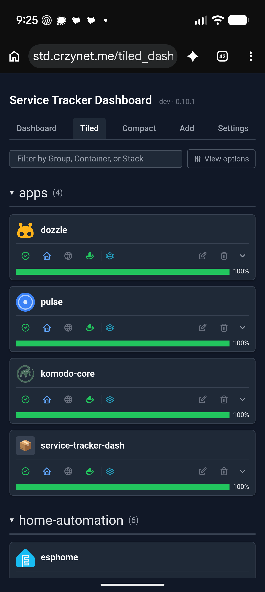

# 🧭 Service Tracker Dashboard (STD)


A homelab-scale Flask dashboard that tracks Docker services across multiple
hosts, runs background URL health checks, and renders a small set of
dashboard views (full, tiled, compact). Service entries are populated and
kept current by a sidecar process — typically
[docker-api-notifier](https://github.com/crzykidd/docker-api-notifier) —
posting to STD's register endpoint, but you can also add entries by hand
through the web UI or directly via API.

> **Compatibility:** STD v0.6.0+ requires `docker-api-notifier` v0.3.0+
> (`/api/v1/register` only). Network, port, and exposure data needs
> notifier v0.4.0+.

---

## Table of Contents

1. [What's New](#whats-new)
2. [What It Does](#what-it-does)
3. [Screenshots](#screenshots)
4. [Configuration](#configuration)
5. [Docker Compose Setup](#docker-compose-setup)
   - [Moving from Docker Hub](#moving-from-docker-hub)
6. [Database Migrations](#database-migrations)
7. [API: Registering Services](#api-registering-services)
8. [Container Labels (via docker-api-notifier)](#container-labels-via-docker-api-notifier)
9. [Files and Paths](#files-and-paths)
10. [Health Checks](#health-checks)
11. [Routes](#routes)
12. [Widgets](#widgets)
13. [Behavior Notes](#behavior-notes)
14. [Versioning & Releases](#versioning--releases)
15. [Development](#development)

---

## What's New

### v0.7.1 (2026-11-15)

Two dashboard conveniences on top of 0.7.0. No migrations, no configuration
change.

- **Clickable Total / Passing / Failing counts** replace "Total Services" in
  the filter bar. Click one to filter the view to it; the active count is
  highlighted.
- **"Show uptime" checkbox** in the filter bar adds a compact 24-hour uptime
  strip (48 half-hour bars plus the uptime %) to every service on Dashboard,
  Tiled and Compact. Off by default and remembered in a browser cookie; hover
  or tap a bar for the failure messages.

### v0.7.0 (2026-11-15)

Dashboard and monitoring. STD is now a dashboard for Docker containers **and**
anything else you run, with simple Gatus-style health monitoring. No notifier
upgrade is needed. Four database migrations run on startup; back up
`/config/services.db` first.

- **Manual entries are first-class.** Non-Docker sites (router, NAS, SaaS)
  are added on the Add page with a Name, optional Host and a Description,
  shown as "Manual" and never flagged stale. A container that later registers
  with the same host and name adopts the entry. "Locked" is now just "Lock
  (ignore notifier updates)".
- **Health checks.** Each entry has an Internal URL check, an External URL
  check, an automatic **Container** check (Docker entries: passes while the
  notifier reports it running) and any number of service checks: HTTP/HTTPS
  (status code, or body mode where `OK` passes and `Error: <message>` fails
  with that message), TCP (`host:port`) and Ping. Each has its own interval
  and timeout, set in one "Health checks" section on Add and Edit.
- **Concurrent checker with a week of history.** Checks run in parallel
  (`health_check_workers`, default 8). Every sample is kept for 24 hours, then
  successes are merged hourly while failures are kept; history is kept for 7
  days (`health_raw_hours`, `health_history_days`).
- **One health badge per service** (Up, Degraded, Down, Unknown, Not
  monitored) on every view, and **Status / Source filters** in the filter bar.
- **Health detail panel** in the Tiled drawer, a Dashboard expand row and the
  Edit page: per-check state, uptime for 24h and 7d, recent failures, a
  24h / 7d bar strip with tooltips, and **Check now**.
- **Add and Edit show their messages** inline.
- **Show uptime** (unreleased): a filter-bar checkbox, remembered in a cookie,
  that adds a 24-hour uptime strip (48 half-hour bars and the uptime %) to
  every service on Dashboard, Tiled and Compact.

### v0.6.9 (2026-11-15)

A hardening and safety-net release. **Read before upgrading:** if you never
set `API_TOKEN`, registers now return 503 until you do, and browser tabs left
open across the upgrade need a reload before their next form submit or delete.

- **Deletes are recoverable.** Deleted services go to the new Settings ->
  Deleted tab for `deleted_retention_days` (default 30) before they are purged.
  A container that registers again before then comes back with its group,
  sort priority, and edits intact. Permanently deleting a service keeps its
  widget as a detached widget you can re-attach.
- **Stale indicator on every view**, driven by one `stale_after_minutes`
  setting (default 5).
- **Per-service health-check options:** a timeout and a "Verify TLS
  certificate" switch for self-signed internal URLs, plus a global
  `health_check_timeout` setting.
- **Fixed:** `widget_value_retention_days` and `register_field_ownership` were
  silently ignored and now work; an unset `API_TOKEN` no longer accepts a bogus
  header.
- **Security:** CSRF protection on every form and in-page request, a
  constant-time token check, the token masked in logs, warnings when the
  default secret key or admin password is still in use, and icon, backup and
  widget paths and post-save redirects confined to STD.
- **Runtime:** the image now runs gunicorn (one worker) with pinned
  dependencies. No configuration change is needed.

### v0.6.8 (2026-11-15)

GHCR is now the only registry -- Docker Hub images are no longer published.
If you still pull `crzykidd/service-tracker-dashboard` from Docker Hub you
are frozen on v0.6.7; switch to `ghcr.io/crzykidd/service-tracker-dashboard`
(see [Moving from Docker Hub](#moving-from-docker-hub)).

- `:dev` and `:latest` images now show the real version number in
  Settings -> Service Info, and the What's New popup works on them.
- Fixed: the Add page no longer returns a server error when Sort Priority
  isn't a number, and the group dropdown stays populated when the form
  re-displays after a validation error.
- The "moved to GHCR" banner from the v0.6.7 Docker Hub image is removed.

### v0.6.7 (2026-11-15)

STD now publishes to GitHub Container Registry (GHCR). If you pull
`crzykidd/service-tracker-dashboard` from Docker Hub, change your image to
`ghcr.io/crzykidd/service-tracker-dashboard` -- this is the last release
published to Docker Hub. Switching is a one-line image change in your
compose file; your config, database, and settings carry over unchanged. See
[Moving from Docker Hub](#moving-from-docker-hub).

- Same tags as before on GHCR: `:latest`, `:dev`, `:<version>`, `:<major>`.
- Installs still running the Docker Hub image show a "moved to GHCR" banner
  on every page (dismissible per browser session) and a note on Settings
  -> Service Info. The GHCR image does not show it.

---

## What It Does

- Three dashboard views (table, tiled, compact). Tiled view shows each service as a tile with a per-tile expand drawer for full host, URL, Docker, network, port, exposure, and widget detail. Icons use [Tabler Icons](https://tabler.io/icons) v3.34.0 (loaded via CDN). Clicking the chart icon on a tile opens the drawer in widget-only mode (showing just the metric cards); the chevron opens the full drawer. The two modes switch in-place without closing and reopening.
- **Stale indicator.** A dynamic service whose last notifier update is older than `stale_after_minutes` (default 5) shows an amber warning icon with a "Stale — updated <time>" tooltip on all three views. Manual and locked entries are never flagged.
- **Dashboard view controls (v0.6.0+).** A `Group by` axis selector
  (`group` / `stack` / `host`) and a `Show URL-less` filter render
  above the service grid on all three views. State is URL-driven, so
  dashboards stay bookmarkable.
- Internal + external URL health checks on a configurable interval.
- **Health badge and filters.** One rolled-up health state per entry (up,
  degraded, down, unknown, not monitored) on all three views, and `Status`
  (`all` / `failing` / `healthy` / `unknown` / `stale`) and `Source`
  (`all` / `notifier` / `manual`) filters next to `Group by`, kept in the URL
  (`?status=failing&source=manual`). The filter bar shows clickable
  **Total**, **Passing** and **Failing** counts that apply the matching
  Status filter (they follow Source and Show URL-less, not Status).
- **Show uptime** checkbox: when ticked, every service shows an inline 24h
  uptime strip. Off by default; remembered in the `std_show_uptime` browser
  cookie rather than the URL, and nothing is fetched while it is off.
- Auto-downloads container icons from
  [Homarr Labs Dashboard Icons](https://github.com/homarr-labs/dashboard-icons).
- Register endpoint for pushing container metadata from external tools.
- SQLite backing store, file-based, no external DB server.
- Daily YAML backups with retention.
- Manual entries: the Add page creates non-Docker entries (Name, optional Host, Description, URLs, group, icon). They show a link icon (Tiled) or "Manual" pill (Dashboard) instead of Docker status and are never stale. If the notifier later registers the same host and name, it takes the entry over. Tiled tiles and Dashboard rows have a one-click trash icon with an inline confirm popover. Locked entries show a lock icon and can only be deleted from the edit page. Deletes are recoverable from Settings → Deleted.
- Optional Dozzle log link integration.
- Local user accounts with session-based auth.
- Per-entry sort priority within groups; grouping and group sort.
- Pluggable widget system (Sonarr, Radarr, Bazarr, Overseerr, Prowlarr,
  Syncthing today; more under `widgets/`).
- **Exposure interpreter (v0.6.0+).** Reads structured exposure
  observations from the notifier's YAML interpreters (Traefik,
  Dockflare, etc.) and synthesizes `internalurl` / `externalurl`
  without requiring operator-written `dockernotifier.std.*` labels.
  Operator UI edits and explicit labels always win over synthesized
  values.

---

## Screenshots

<!-- TODO(v0.6.1): Still outstanding as of v0.6.9. Screenshots below predate the v0.6.1 tile redesign (host line removed from tile face, icon-row status strip, expand drawer replacing inline widget data, Tabler icons replacing emoji badges). Refresh before next public announcement. -->

| Main Dashboard | Tiled View | Compact View |
|---|---|---|
| [](docs/screenshots/std_main_dashboard.png) | [](docs/screenshots/std_tile_dashboard.png) | [](docs/screenshots/std_compact_dashboard.png) |

| Mobile View | Widgets | Settings |
|---|---|---|
| [](docs/screenshots/std_mobile.png) | [](docs/screenshots/std_widgets.png) | [](docs/screenshots/std_settings.png) |

---

## Configuration

STD reads config from environment variables and an optional
`/config/settings.yml`. Environment variables take priority. If
`settings.yml` is missing, defaults apply and a `settings.example.yml`
is dropped into `/config` for reference.

Default login: `admin` / `changeme123`. Change it on first run.

### Settings reference

| Setting                    | Type   | ENV                          | Default            | What it does |
|----------------------------|--------|------------------------------|--------------------|--------------|
| `api_token`                | string | `API_TOKEN`                  | —                  | Bearer token required by `/api/v1/register`. If unset, register returns 503 until it is set. The token is masked in logs. |
| `std_dozzle_url`           | string | `STD_DOZZLE_URL`             | —                  | Optional link to a Dozzle instance; enables a Tools section in the UI. |
| `backup_path`              | string | `BACKUP_PATH`                | `/config/backups`  | Where YAML backups are written. |
| `backup_days_to_keep`      | int    | `BACKUP_DAYS_TO_KEEP`        | `7`                | Backup retention. |
| `url_healthcheck_interval` | int    | `URL_HEALTHCHECK_INTERVAL`   | `300`              | Seconds between health check passes. |
| `health_check_timeout`     | int    | `HEALTH_CHECK_TIMEOUT`       | `5`                | Seconds a URL health check waits before failing. Each service can override it on its edit page (1-60). |
| `health_check_workers`     | int    | `HEALTH_CHECK_WORKERS`       | `8`                | How many health checks run at the same time. |
| `health_raw_hours`         | int    | `HEALTH_RAW_HOURS`           | `24`               | Hours every health-check sample is kept individually. Older successes are merged into one row per unbroken run per clock hour (failures are always kept); an hourly job at :05 does this. |
| `health_history_days`      | int    | `HEALTH_HISTORY_DAYS`        | `7`                | Days of health-check history kept; an hourly job at :03 deletes older rows. |
| `api_audit_retention_days` | int    | `API_AUDIT_RETENTION_DAYS`   | `90`               | Days the management-API write audit log is kept; a daily 00:35 job deletes older rows. |
| `widget_background_reload` | int    | `WIDGET_BACKGROUND_RELOAD`   | `900`              | Seconds between widget data refreshes. |
| `widget_value_retention_days` | int | `WIDGET_VALUE_RETENTION_DAYS` | `30`            | Days of `widget_value` history to retain. A daily 00:15 background job prunes older rows. |
| `deleted_retention_days`   | int    | `DELETED_RETENTION_DAYS`     | `30`               | Days a deleted service stays recoverable in Settings → Deleted before a daily 00:25 job removes it permanently. `0` purges at the next run. |
| `stale_after_minutes`      | int    | `STALE_AFTER_MINUTES`        | `5`                | Minutes without a notifier update before a dynamic service is flagged stale (warning icon on the Dashboard, Tiled, and Compact views). Manual and locked entries are never stale; the notifier re-scans every 60 s by default. |
| `register_field_ownership` | string | `REGISTER_FIELD_OWNERSHIP`   | `user_wins`        | How register calls handle conflicts with UI edits on `group_name` and `sort_priority`. `user_wins` (default) preserves non-NULL UI values on update; `notifier_wins` always overwrites. Invalid values fall back to `user_wins` with a startup warning. |
| `user_session_length`      | int    | `USER_SESSION_LENGTH`        | `120`              | User session length in minutes. |
| `flask_secret_key`         | string | `FLASK_SECRET_KEY`           | —                  | Required for production. Used to sign session cookies. If unset, a built-in default is used and Settings shows a warning (as it does while `admin` still has the default password). |

### Example `settings.yml`

```yaml
api_token: supersecrettoken
std_dozzle_url: http://dozzle.local
backup_path: /config/backups
backup_days_to_keep: 7
url_healthcheck_interval: 300
health_check_timeout: 5
health_check_workers: 8
health_raw_hours: 24
health_history_days: 7
api_audit_retention_days: 90
widget_background_reload: 900
widget_value_retention_days: 30
register_field_ownership: user_wins
stale_after_minutes: 5
user_session_length: 120
```

---

## Docker Compose Setup

```yaml
services:
  service-tracker-dashboard:
    image: ghcr.io/crzykidd/service-tracker-dashboard:latest
    container_name: service-tracker-dashboard
    ports:
      - 8815:8815
    environment:
      - API_TOKEN=supersecrettoken
      - STD_DOZZLE_URL=http://dozzle.local
      - FLASK_DEBUG=0
      - FLASK_SECRET_KEY=changeme-in-prod
    volumes:
      - ./config:/config
    restart: unless-stopped
```

### Moving from Docker Hub

STD images are published to **GitHub Container Registry (GHCR)** only.
Docker Hub images (`crzykidd/service-tracker-dashboard`) are no longer
published; **v0.6.7 was the last one** and it will not receive further
updates.

To move, change one line in your compose file:

```diff
-    image: crzykidd/service-tracker-dashboard:latest
+    image: ghcr.io/crzykidd/service-tracker-dashboard:latest
```

Then pull and recreate:

```bash
docker compose pull
docker compose up -d
```

Nothing else changes: the tags are the same (`:latest`, `:dev`,
`:<version>`, `:<major>`), and your `/config` volume, database, and
settings carry over as-is. If you pin a version, use the same tag on
GHCR (e.g. `ghcr.io/crzykidd/service-tracker-dashboard:0.6.7`).
Docker Hub images stop at v0.6.7; GHCR is the only registry from v0.6.8 on.

---

## Database Migrations

Schema changes are tracked with [Alembic](https://alembic.sqlalchemy.org/).
Migrations live in `alembic/versions/` and `alembic upgrade head` runs
automatically on container start (see `entrypoint.sh`).

To create a new migration after changing models, exec into a running
container:

```bash
docker compose exec <service-name> \
  alembic revision --autogenerate -m "describe the change"
```

The new revision file lands under `alembic/versions/`. Review it before
committing — autogenerate doesn't catch every kind of change
(constraint renames, default-only changes, SQLite-specific quirks).

To check whether models and the live database have diverged without
writing a migration:

```bash
docker compose exec <service-name> alembic check
```

---

## API: Registering Services

`/api/v1/register` is the only register endpoint. The legacy
`/api/register` shim that bridged v0.4.x producers through v0.5.0
was removed in v0.6.0; producers must run `docker-api-notifier`
v0.3.0+ or send canonical-key payloads directly.

### Endpoint

```
POST /api/v1/register
Authorization: Bearer <API_TOKEN>
Content-Type: application/json
```

### Canonical payload

```json
{
  "host": "docker01",
  "container_name": "nginx",
  "container_id": "abc123...",
  "image_name": "ghcr.io/user/nginx:latest",
  "image_icon": "nginx.svg",
  "docker_status": "running",
  "stack_name": "frontend",
  "started_at": "2026-05-10T12:34:56Z",
  "timestamp": "2026-05-10T12:35:00Z",
  "internalurl": "http://nginx:80",
  "externalurl": "https://my.domain.com",
  "internal_health_check_enabled": true,
  "external_health_check_enabled": true,
  "group_name": "web",
  "sort_priority": 1,
  "networks": [
    {"name": "proxy", "aliases": ["frontend"]},
    {"name": "ammoledger_default", "aliases": ["frontend"]}
  ],
  "exposed_ports": ["5173/tcp"],
  "published_ports": [
    {"container_port": 5173, "protocol": "tcp",
     "host_ip": "0.0.0.0", "host_port": 8080}
  ],
  "exposure_observations": [
    {"layer": "traefik", "hostname": "nginx.internal.example",
     "tls": true, "path_prefix": null, "auth": null, "details": null},
    {"layer": "dockflare", "hostname": "nginx.example.com",
     "tls": true, "path_prefix": null,
     "auth": "cloudflare_access:authenticate", "details": null}
  ]
}
```

### Required fields

- `host` — Docker host name. Composite key with `container_name`.
- `container_name` — name of the container.

Everything else is optional. STD applies sensible defaults for any
field that's missing.

`/api/v1/register` is **strict** — unknown keys are rejected with a
400 and the list of offending keys in the response body. Nested
structures (`networks`, `published_ports`) are also validated via
pydantic; malformed entries are rejected at the schema boundary.

### Field ownership: user_wins vs notifier_wins

`group_name` and `sort_priority` can be edited in the web UI. When a
notifier register arrives for a row whose UI value differs, the
`register_field_ownership` setting decides who wins:

- **`user_wins`** (default) — UI edits stick. The notifier may
  populate these fields on a new row or one where they're still
  NULL, but it won't overwrite a value the operator has set.
- **`notifier_wins`** — every register call overwrites everything,
  including UI edits. Choose this if your container labels are the
  source of truth.

Regardless of mode, STD records what the notifier sent in
`notifier_reported_group_name` and `notifier_reported_sort_priority`
columns. These columns aren't surfaced in the UI yet — they support
a planned overridden-labels export.

### Network and ports capture (v0.6.0+)

The three optional `networks` / `exposed_ports` / `published_ports`
fields are pure observation — STD overwrites them on every register
call with no ownership semantics. They're populated by
`docker-api-notifier` v0.4.0+; pre-v0.4.0 notifiers continue to work
and just leave the columns NULL.

The read-only "Reported by notifier" block at the bottom of
`/edit/<id>` surfaces this data. Empty / NULL columns render as "Not
reported." Manual entries (added through the UI) have no such block and won't
have this data, and that's expected.

### Exposure observations + URL synthesis (v0.6.0+)

The optional `exposure_observations` field carries structured output
from the notifier's YAML interpreters (Traefik, Dockflare, …).
Notifier v0.4.0+ runs these interpreters and emits one entry per
interpreter that recognizes the container. STD writes them into the
new `service_exposure` table and runs a synthesizer that may
populate `internalurl` / `externalurl` automatically.

Operators tell STD what each layer means at `/settings` →
**Exposure** tab. Each discovered layer (only layers that have been
observed appear) gets a direction dropdown:

- **internal** — synthesized hostname populates `internalurl`.
- **external** — synthesized hostname populates `externalurl`.
- **neither** (default) — STD records the observation and shows a
  badge, but doesn't synthesize a URL from this layer.

Per-host overrides let you say "Traefik on the home host is
internal, but Traefik on the edge VPS is external" without writing
different YAML per host.

#### URL provenance

The two `internalurl` / `externalurl` columns now track who last
wrote them via two new `_source` columns. Ordering, strongest last:

1. **NULL** — no value, no opinion. Synthesizer is free to fill in.
2. **`synthesized`** — value came from the synthesizer. Re-runs on
   every register and on settings save may change it.
3. **`explicit_label`** — value came from a
   `dockernotifier.std.internalurl` / `.externalurl` label on the
   container. Synthesizer won't overwrite. A new explicit label
   updates it; a UI edit overrides.
4. **`ui_edit`** — operator typed a value in the web UI. Nothing
   overrides until another UI edit. Clearing the field resets the
   source to NULL so synthesis can resume.

The edit page (`/edit/<id>`) shows a small badge next to each URL
indicating the current source.

#### Wire-level semantics

- `exposure_observations` **absent** or **null** — "no update."
  Existing exposure rows for the service are preserved. This is the
  state for pre-v0.4.0 notifiers and any producer that doesn't emit
  interpreter output.
- `exposure_observations: []` — "this container has no interpreter
  matches." All existing exposure rows for the service are
  cleared. The synthesizer may then clear any URL whose source is
  `synthesized`.
- `exposure_observations: [ ... ]` — wholesale replacement. All
  prior rows for this service are dropped, the new rows are
  inserted, and the synthesizer recomputes URLs (respecting
  provenance).

#### Badges and headless rendering

Each tile (tiled view) and row (table view) renders up to three
exposure badges showing the layer name, a lock icon (`ti-lock`) if
TLS-terminated, and a key icon (`ti-key`) if auth is required. A `+N`
overflow badge appears when a service is observed by more than three
interpreters.

Services with no exposure observations **and** no URLs (manual,
explicit, or synthesized) are considered "headless." Their tiles
render without click affordance and rely on `docker_status` for
state. Combine with the `?show_urlless=false` view-control filter
(v0.6.0) to hide them entirely.

---

## Container Labels (via docker-api-notifier)

If you run [docker-api-notifier](https://github.com/crzykidd/docker-api-notifier)
on each Docker host, you can drive STD entirely from labels in your
compose files:

```yaml
labels:
  dockernotifier.notifiers: service-tracker-dashboard
  dockernotifier.std.internalurl: http://nginx:80
  dockernotifier.std.externalurl: https://nginx.domain.com
  dockernotifier.std.group: web
  dockernotifier.std.internal.health: "true"
  dockernotifier.std.sort.priority: "1"
```

Notifier v0.3.0+ emits canonical keys to `/api/v1/register` automatically.

---

## Files and Paths

| Path                     | Purpose                          |
|--------------------------|----------------------------------|
| `/config/services.db`    | SQLite database (WAL mode).      |
| `/config/std.log`        | Main app log (rotated).          |
| `/config/images/`        | Cached service icons.            |
| `/config/backups/`       | YAML backups (manual + nightly). |
| `/config/settings.yml`   | Optional config file.            |

---

## Health Checks

- A scheduler wakes every 5 seconds and runs whichever checks are due, up to
  `health_check_workers` (default 8) at a time, so one slow service no longer
  delays the rest. A check is due once its interval (the
  `url_healthcheck_interval` default of 300 seconds, or its own interval of
  30 seconds or more) has passed since it last ran; a new check runs at the
  next tick.
- Check types: HTTP/HTTPS (status code, or in *body* mode a reply of `OK`;
  an `Error: ...` reply shows the text as the failure message), TCP connect
  to `host:port`, and ping (ICMP echo, 3 packets). Ping needs the `NET_RAW`
  capability, which Docker grants by default; without it the check fails with
  "ICMP not permitted".
- Every run is stored. Samples are kept individually for `health_raw_hours`
  (24 h), then successes are merged into hourly ranges, and everything older
  than `health_history_days` (7) is deleted.
- Internal and external URLs are pinged if their respective
  `*_health_check_enabled` flags are set.
- Status code, response time, and timestamp are recorded per check, as a
  result row in the database. An entry's badge rolls its enabled checks up:
  **Up** (every check that has run passed), **Degraded** (some pass, some
  fail), **Down** (every check that has run fails), **Unknown** (checks are
  enabled but none has run yet), **Not monitored** (no enabled checks). A URL
  check whose URL is empty does not count.
- Each entry has an internal-URL and an external-URL check; the notifier's
  `*_health_check_enabled` flags turn them on, and each has its own timeout
  and verify-TLS options on the Edit page.
- Each check waits up to `health_check_timeout` seconds (default 5). A
  service can override this, and turn off TLS certificate verification
  (for self-signed internal URLs that otherwise show `Error: SSLError`),
  in the **Health checks** section of its Edit page (also on the Add page).
- Each URL check also has its own enabled switch, mode (status code or
  response body), interval (30-86400 s) and timeout (1-60 s).
- **Service checks** are extra checks you add per entry on the Edit or Add
  page: HTTP/HTTPS (full URL), TCP (`host:port`) and Ping (hostname or IP).
  The notifier never touches them. Removing one deletes it and its results
  when you save.
- **Container check.** Every notifier (Docker) entry has an automatic
  *Container* check: it passes while the notifier reports the container
  `running` and has reported within `stale_after_minutes`, and fails with
  `Container <state>` or `No update from notifier ...` otherwise. It is
  evaluated by the scheduler (no network), shows up within about 5 seconds of
  a state change, and has only an enabled switch and an interval on the Edit
  page. Manual entries have none, and a locked entry's container check is not
  run or counted until you unlock it.
- A failed check logs and moves on; it does not crash the loop.

### Health checks and monitoring

- **Kinds.** Each entry has an *Internal URL* and an *External URL* check
  (they follow the entry's URLs) plus any *service checks* you add, and
  notifier entries also have a *Container* check (Docker state). Types:
  HTTP/HTTPS, TCP and Ping.
- **Body mode.** An HTTP check in *response body* mode passes when the reply
  is `OK`; a reply of `Error: <message>` fails and shows `<message>`.
- **Retention.** `health_raw_hours` (24) keeps every sample; older successes
  are merged into one row per hour and run, failures are kept as they
  happened; `health_history_days` (7) bounds everything.
- **Badge and filters.** One rolled-up badge per entry on every view, and
  Status / Source filters beside "Group by" (see above).
- **Detail view.** Open the Tiled drawer, the Dashboard row chevron or the
  Edit page's "Health history" section to see each check's state, uptime
  (24 h and 7 d), recent failures and a bar strip: green is all passes, red
  is any failure, grey is no data. Hover or tap a bar for its time range and
  failure messages. The **24h / 7d** toggle switches between 48 half-hour and
  168 hourly bars, and **Check now** runs the entry's checks within a few
  seconds. Compact has no panel; its dot links to the Edit page.

---

## Routes

| Route                | Purpose                                  |
|----------------------|------------------------------------------|
| `/`                  | Main dashboard (table view).             |
| `/tiled_dash`        | Grid-style dashboard.                    |
| `/compact_dash`      | High-density compact view.               |
| `/add`               | Add a manual (non-Docker) entry.         |
| `/edit/<id>`         | Edit or delete (soft-delete) an existing entry. |
| `/service/<id>/health` | Health detail JSON (`?range=24h\|7d`, login). |
| `/health/strips?ids=1,2,3` | 24h uptime strips for up to 500 entries (JSON, login). |
| `/service/<id>/checks/run` | Check now (POST, login). |
| `/settings`          | Settings + backup/restore UI (incl. Exposure tab). |
| `/settings/deleted/<id>/restore` | Restore a soft-deleted entry (admin POST). |
| `/settings/deleted/<id>/delete`  | Permanently delete a soft-deleted entry (admin POST). |
| `/settings/api-keys` `/settings/api-keys/<id>/revoke` | Create (shown once) and revoke admin API keys (admin POST). |
| `/settings/exposure` | Save per-interpreter direction settings + recompute synthesized URLs (admin POST). |
| `/dbdump`            | Raw dump of all DB entries (admin).      |
| `/images/<file>`     | Serve cached icon files.                 |
| `/api/v1/register`   | Register/update entry (canonical keys; notifier `api_token`). |
| `/api/v1/whoami`     | Management API: the calling key's name, prefix and scope (admin API key). |
| `/api/v1/entries[/<id>]` `/api/v1/entries/<id>/{restore,checks,checks/run,health}` `/api/v1/checks/<id>` `/api/v1/health/summary` | Management API: list, create, edit, delete and restore entries; manage checks; run checks now; health (admin API key; `write` scope for changes). |
| `/login` `/logout`   | Local user auth.                         |

### Admin API keys (management API)

Settings → **API** creates admin API keys for the management API under
`/api/v1` (v0.8.0, in progress: `whoami`, entries, checks, Check now, entry
health and `/health/summary` so far; groups, widgets and runtime settings
follow, then the OpenAPI spec and examples). Keys are separate from the notifier's
`api_token`, which can only register services and is rejected here, and a
management key is rejected by `/api/v1/register`.

- Pick a name (unique, up to 64 characters) and a scope: **read** or **write**
  (write includes read). The full key (`std_<prefix>_<secret>`) is shown
  **once** with a Copy button; only a hash is stored, so a lost key means
  revoking it and creating another.
- Send it as `Authorization: Bearer <key>`. Browser sessions do not
  authenticate the management API.
- The key list shows prefix, scope, created, last used (time and IP) and
  status. Revoked keys stay listed, greyed out.
- Every write made with a key (POST, PATCH, PUT, DELETE, including rejected
  ones) is recorded in an audit log, with secret values masked. Rows are kept
  for `api_audit_retention_days` (90).

---

## Widgets

Widgets live under `widgets/<name>/` and are loaded dynamically. Each
widget directory contains:

- `__init__.py`
- `fetch_data.py` — pulls data from the upstream service.
- `settings.json` — declarative config schema.
- `README.md` — widget docs.

Built-in widgets: Sonarr, Radarr, Bazarr, Overseerr, Prowlarr, Syncthing.

Widget data is sampled on the `widget_background_reload` interval and
cached in the `widget_value` table. Retention: rolling 30 days
(introduced in v0.5.0).

When a service is permanently deleted (Delete permanently, or the nightly
purge) its widget is kept as a **detached widget** rather than erased: the
settings and stored values remain, but it is no longer refreshed. Settings →
Deleted lists detached widgets and lets you **Attach** one to an active service
that has no widget, or **Delete** it (with its values). Widgets that belong
only to soft-deleted services are also not refreshed until the service is
restored.

---

## Behavior Notes

- Deleting a service is a soft delete: it disappears from the dashboards and
  stops being health-checked, and can be restored from Settings → Deleted
  until `deleted_retention_days` passes. If its container registers again
  first, the entry is restored automatically with its edits intact.
- Entries with **Lock (ignore notifier updates)** ticked are not touched by API register calls. An unlocked manual entry that matches a register call (same host and name) is adopted by the notifier and becomes a notifier entry.
- Icon fetch falls back to a lowercased, hyphenated container name when
  no explicit icon is provided.
- Nightly backups run shortly after midnight; old backups are pruned
  per `backup_days_to_keep`.
- Version metadata is shown in `/settings`.
- All UI forms and in-page delete requests are CSRF-protected. If a form
  was left open past a session expiry, submitting it shows a "please retry"
  message instead of acting. `/api/v1/register` (bearer token) is exempt.
- Tile drawers on the Tiled view are transient view state and not bookmarkable; full edit remains at `/edit/<id>` and is bookmarkable.

---

## Versioning & Releases

Images are published to `ghcr.io/crzykidd/service-tracker-dashboard`.
Docker Hub (`crzykidd/service-tracker-dashboard`) is no longer published;
v0.6.7 was its last release — see
[Moving from Docker Hub](#moving-from-docker-hub).

- `:latest` follows `main` and is re-tagged on every GitHub Release.
- `:dev` follows `dev` — work in progress.
- `:sha-<short>` published for every push.
- Semver-tagged images (`:0.6.0`, `:0`) published from GitHub Releases.
- The version number lives in the `VERSION` file at the repo root. The
  Docker build writes it into the image, so `:dev` and `:latest` images
  report the real version in Settings -> Service Info.

Branch protection: PRs into `main` must pass the image build check, CodeQL,
and the CI checks (Lint, Config validation, Migration check, Compose
validation); force-push and branch deletion are blocked. Old GHCR image
versions are pruned automatically (30 most recent `sha-*`, 15 most recent
semver; `latest`, `dev`, and major tags are kept). Work happens on `dev`
and opens a PR to `main`, which merges only when CI is green.

Releases are cut with two slash commands (`.claude/commands/`):
`/release-prep <version>` on `dev` bumps `VERSION`, rolls the CHANGELOG,
syncs the README and docs, and opens the `dev` -> `main` PR; after the PR
is merged and `main` CI is green, `/release-cut <version>` tags `v<version>`
and publishes the GitHub Release (whose notes are the CHANGELOG section).
The publish workflow refuses a release whose tag does not match `VERSION`.

---

## Development

Work happens on the `dev` branch and reaches `main` through a pull request.
A PR merges only when the required checks are green: `build` (image build),
CodeQL, and the CI jobs `Lint`, `Test`, `Config validation`, `Migration check`,
and `Compose validation`. Lint (`ruff.toml`) selects `E, W, F, I, B` (pycodestyle,
pyflakes, import sorting, flake8-bugbear) with `E501` ignored; run
`uvx ruff@0.15.17 check .` before pushing.

Run the test suite locally (Python 3.11):

```bash
pip install -r requirements-dev.txt
pytest -q
```

The tests run against a temporary config directory. `STD_CONFIG_DIR` (default
`/config`) is a dev/test knob that relocates the settings file, database, logs,
images, and backups; leave it unset in production.

Production runs under gunicorn with **exactly one worker** (see
`gunicorn.conf.py`; the scheduler, health-check thread and register lock are
in-process, so do not raise `workers`). `FLASK_DEBUG=1` runs `python app.py`
(Werkzeug with auto-reload) instead; the default does not.

Dependencies are pinned. Edit `requirements.in` (the direct dependencies), then
regenerate the pinned `requirements.txt`:

```bash
uv pip compile --python-version 3.11 requirements.in -o requirements.txt
```

`requirements-dev.txt` adds pytest on top of the pinned set.

Releases go through `/release-prep` and `/release-cut` (see
[Versioning & Releases](#versioning--releases)). Contributor and agent
guidance lives in [`CLAUDE.md`](CLAUDE.md); adopted engineering standards in
[`standards.md`](standards.md); handoff prompts in [`prompts/`](prompts/); and
non-obvious design decisions in [`docs/decisions.md`](docs/decisions.md).
The design record is [`docs/PRD.md`](docs/PRD.md).

---

## License

MIT — see [LICENSE](LICENSE).
