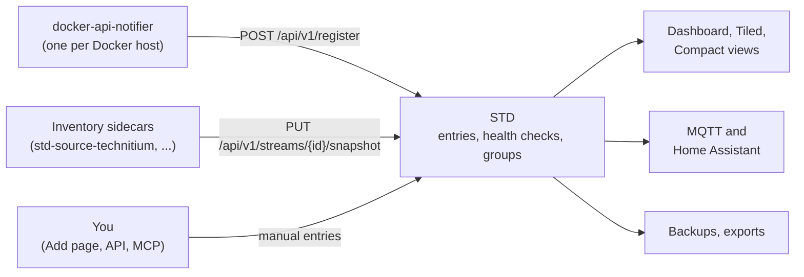
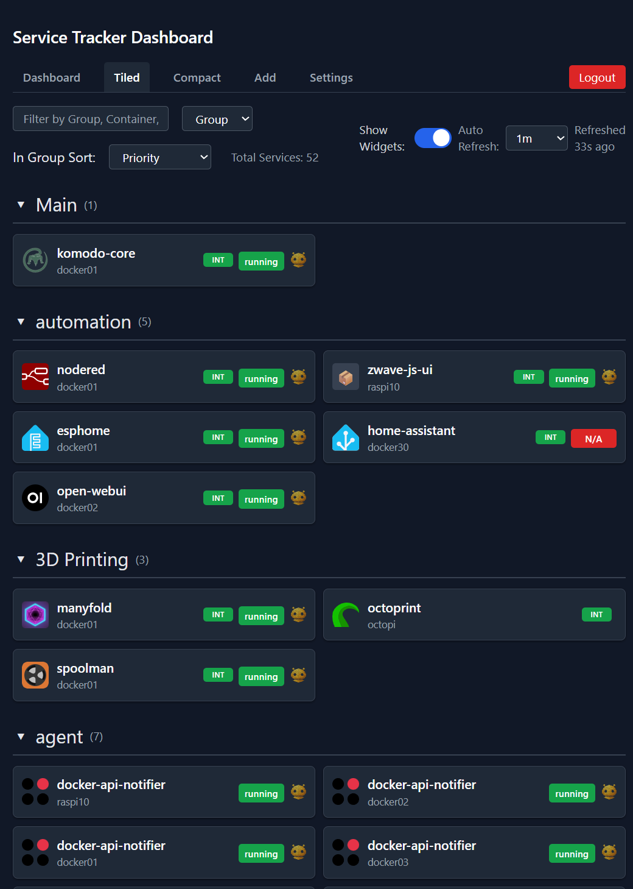
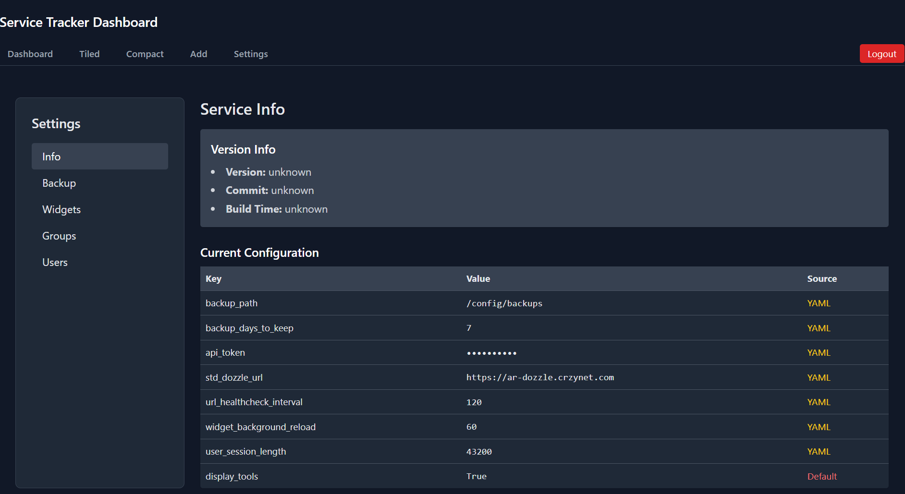

# 🧭 Service Tracker Dashboard (STD)


STD is a self-populating infrastructure dashboard: one view of what runs on your
network. It builds itself from sources. Docker containers register through
[docker-api-notifier](https://github.com/crzykidd/docker-api-notifier), sidecars push
device lists such as DHCP reservations, and you add anything else by hand. STD then
checks the health of every entry, groups it, and publishes it to MQTT and Home
Assistant. A management API and an MCP server let scripts and Claude run it. It is a
single container with a SQLite database.



> **Compatibility:** STD 0.6.0+ needs docker-api-notifier 0.3.0+. Network, port and
> exposure data needs notifier 0.4.0+. See [docs/register-api.md](docs/register-api.md#compatibility).

---

## Contents

1. [What It Does](#what-it-does)
2. [What's New](#whats-new)
3. [Screenshots](#screenshots)
4. [Quick Start](#quick-start)
5. [Configuration](#configuration)
6. [Sources](#sources)
   - [Docker: docker-api-notifier](#docker-docker-api-notifier)
   - [Inventory streams](#inventory-streams)
   - [Manual entries](#manual-entries)
7. [Dashboards](#dashboards)
8. [Health Checks](#health-checks)
9. [Widgets](#widgets)
10. [Notifications and Home Assistant](#notifications-and-home-assistant)
11. [Management API](#management-api)
12. [Managing STD with Claude (MCP)](#managing-std-with-claude-mcp)
13. [Backup, Export, Import and Restore](#backup-export-import-and-restore)
14. [Settings and Routes](#settings-and-routes)
15. [Development](#development)
16. [Versioning and Releases](#versioning-and-releases)

Reference pages: [register API](docs/register-api.md) ·
[inventory streams](docs/inventory-streams.md) ·
[MQTT and Home Assistant](docs/mqtt-home-assistant.md) ·
[MCP server](mcp/README.md) · [CHANGELOG](CHANGELOG.md) · [PRD](docs/PRD.md)

---

## What It Does

### Sources

- **Docker.** docker-api-notifier on each Docker host registers its containers:
  status, image, stack, labels, networks and ports. Exposure seen by its interpreters
  (Traefik, Dockflare, ...) becomes internal and external URLs automatically.
- **Inventory streams.** A sidecar pushes a full device list on a schedule, for example
  DHCP reservations from Technitium via `std-source-technitium`. A new stream waits as
  *pending* until you preview and enable it; devices that match an entry you already
  have are offered as links instead of duplicates.
- **Manual entries.** Anything else (router, NAS, a SaaS page) from the Add page, the
  API or MCP.

### On top of that

- **Views:** Dashboard (table), Tiled and Compact, all usable on a phone. Group by
  group, stack or host; filter by health status and source; per-entry sort priority.
- **Health checks:** internal and external URL checks, a Docker container check, and
  any number of HTTP/HTTPS, TCP, ping and DNS checks per entry, with certificate expiry.
  One rolled-up badge per entry, a week of history, uptime strips.
- **Widgets:** Sonarr, Radarr, Bazarr, Overseerr, Prowlarr and Syncthing data on tiles.
- **MQTT and Home Assistant:** retained state per entry, check and stream, and Home
  Assistant discovery for the entries you pick.
- **Management API and MCP:** everything the UI does, over JSON with scoped API keys,
  plus an MCP server so Claude can manage STD. Every write is audited.
- **Backup, export, import and restore:** scheduled database snapshots and secret-free
  settings exports, import with a preview, and a staged database restore.
- Icons from [Homarr Labs Dashboard Icons](https://github.com/homarr-labs/dashboard-icons),
  optional [Dozzle](https://dozzle.dev/) log links, local user accounts, recoverable
  deletes.

---

## What's New

One block per release, newest first. The [CHANGELOG](CHANGELOG.md) is the full record.

<!-- release-prep: replace the 0.11.0 heading below with "### v0.11.0 (<date>)" and point
     its link at the new CHANGELOG anchor (for example #0110--2026-11-22). -->
### v0.11.0 (unreleased, on `dev`)

- **Backups you can configure:** a database snapshot and a settings export, each with
  its own time, keep days and Run now, in Settings → Backup & restore.
- **Export and import:** a secret-free YAML or JSON export; import it (or an old YAML
  backup) with stream mapping and a preview, filling only missing values by default.
- **Staged restore:** pick a snapshot, and STD swaps it in on the next container start,
  keeping the current database.
- **Settings regrouped** into six groups with a link per section (`/settings#streams`),
  cards and dialogs throughout. API revision 4.
- **Compact details:** an expand button on each Compact tile opens a dialog with the
  entry's details, health history, and Edit and Delete.
- **Dashboard expanded row** shows the same details as the tile drawer, beside the
  health history.

[Full entry](CHANGELOG.md#unreleased)

### v0.10.1 (2026-11-20)

- **Stale streams** are flagged in Settings, the health summary, MQTT and Home Assistant.
- **Missing since** badge on entries that dropped out of a snapshot; optional expiry.
- **Checks follow a changed IP** reported by a stream. API revision 3.

[Full entry](CHANGELOG.md#0101--2026-11-20)

### v0.10.0 (2026-11-19)

- **MQTT notifications** with retained entry, check and summary state.
- **Home Assistant discovery** for the entries you pick, with purge tools.
- **Inventory streams:** sidecars push device lists; pending review, filters, link offers.
- **Version in the header** with an update check. API revision 2.

[Full entry](CHANGELOG.md#0100--2026-11-19)

### v0.9.0 (2026-11-16)

- **DNS checks** against a chosen server, and **certificate expiry** on HTTPS checks.
- **Clearer health:** failing checks are never softened by a running container.
- **Tiled view redesign** and **API key rotation**.

[Full entry](CHANGELOG.md#090--2026-11-16)

### v0.8.0 (2026-11-15)

- **Management API** under `/api/v1` with read and write API keys and an OpenAPI spec.
- **Write audit log** in Settings → Audit log.
- **MCP server** so Claude can manage STD.

[Full entry](CHANGELOG.md#080--2026-11-15)

### v0.7.1 (2026-11-15)

- **Clickable Total / Passing / Failing counts** in the filter bar.
- **Show uptime:** a 24-hour uptime strip on every entry.

[Full entry](CHANGELOG.md#071--2026-11-15)

### v0.7.0 (2026-11-15)

- **Manual entries are first-class** and adopted when a matching container registers.
- **Health checks:** URL, container, HTTP, TCP, ping and DNS, with a week of history.
- **One health badge per entry**, Status and Source filters, a health detail panel.

[Full entry](CHANGELOG.md#070--2026-11-15)

### v0.6.9 (2026-11-15)

- **Recoverable deletes** (Settings → Deleted) and a **stale indicator** on every view.
- **Security hardening:** CSRF, register returns 503 until `API_TOKEN` is set.
- **gunicorn** with one worker and pinned dependencies.

[Full entry](CHANGELOG.md#069--2026-11-15)

Older releases, including the 0.6.7 move to GHCR, are in the [CHANGELOG](CHANGELOG.md).

---

## Screenshots

| Main Dashboard | Tiled View | Compact View |
|---|---|---|
| [](docs/screenshots/std_main_dashboard.png) | [](docs/screenshots/std_tile_dashboard.png) | [](docs/screenshots/std_compact_dashboard.png) |

| Mobile View | Widgets | Settings |
|---|---|---|
| [](docs/screenshots/std_mobile.png) | [](docs/screenshots/std_widgets.png) | [](docs/screenshots/std_settings.png) |

<!-- screenshot needed: Settings -> Streams with one pending stream card (Preview / Enable / Ignore) and one enabled stream card -->
<!-- screenshot needed: the import preview page (/settings/import/<token>) with grouped rows, one row opened to its per-field table -->
<!-- screenshot needed: Settings -> Home Assistant entry picker, and the Home Assistant device page of one STD entry -->
<!-- screenshot needed: the health detail panel (Tiled drawer or Dashboard expand row) with the 24h bar strip -->
| Streams | Import preview | Home Assistant | Health detail |
|---|---|---|---|
| [](docs/screenshots/std_streams.png) | [](docs/screenshots/std_import_preview.png) | [](docs/screenshots/std_home_assistant.png) | [](docs/screenshots/std_health_detail.png) |

---

## Quick Start

### Docker Compose

```yaml
services:
  std:
    image: ghcr.io/crzykidd/service-tracker-dashboard:latest
    container_name: std
    ports:
      - 8815:8815
    environment:
      - API_TOKEN=change-me-register-token       # the notifier's register token
      - FLASK_SECRET_KEY=change-me-long-random   # signs session cookies
      - TZ=Europe/London                         # local time for the daily jobs
      # - STD_DOZZLE_URL=http://dozzle.lan:8080
    volumes:
      - ./config:/config
    restart: unless-stopped
```

```bash
docker compose up -d
```

Open `http://<host>:8815` and sign in as `admin` / `changeme123`. Change the password
(Settings → Users); STD shows a warning while the default password or the default
secret key is in use. On every start the container applies a staged restore if there
is one, runs the database migrations (`alembic upgrade head`), and starts gunicorn on
port 8815. `GET /healthz` answers `{"status": "ok"}` while it runs.

Next steps:

1. Run docker-api-notifier on each Docker host with the same `API_TOKEN`
   ([Docker](#docker-docker-api-notifier)).
2. Optionally, run an inventory sidecar with an **ingest** key
   ([Inventory streams](#inventory-streams)).
3. Add anything else on the Add page ([Manual entries](#manual-entries)).

Image tags: `:latest` (main), `:<version>` and `:<major>` (releases), `:dev` (work in
progress), `:sha-<short>` (every push).

### Moving from Docker Hub

Images are published to **GHCR only**. Docker Hub (`crzykidd/service-tracker-dashboard`)
stopped at 0.6.7. Change the image line and recreate; `/config` carries over as-is and
the tags are the same:

```diff
-    image: crzykidd/service-tracker-dashboard:latest
+    image: ghcr.io/crzykidd/service-tracker-dashboard:latest
```

```bash
docker compose pull && docker compose up -d
```

---

## Configuration

### Where settings come from

- **Startup settings** come from environment variables and an optional
  `/config/settings.yml`. An environment variable wins over the file; a missing key
  uses the default. They are read **once at startup**, so restart the container after
  changing them. If `settings.yml` is missing, defaults apply. On every start STD
  writes the current `settings.example.yml` to `/config` for reference.
- **Runtime settings** are edited in Settings and stored in the database (backups,
  update check, Docker layer directions, stream settings, Home Assistant picks). They
  are listed [below](#settings-stored-in-the-database).
- **Backup folder and keep days** are both: precedence is
  **environment > Settings UI > `settings.yml` > default**. `settings.yml` only gives
  the initial value; a value saved in Settings wins over it, and **Reset** goes back to
  it. An environment variable pins the value: Settings shows it read-only with the
  variable's name and refuses a change.

**Settings → Configuration** shows every startup setting with where it came from
(environment, file or default), and `GET /api/v1/config` returns the same with secrets
masked.

### settings.yml and environment variables

| `settings.yml` key | Environment | Default | What it does |
|---|---|---|---|
| `api_token` | `API_TOKEN` | none | Bearer token for `/api/v1/register` (the notifier). Unset: register answers 503. Masked in logs. |
| `std_dozzle_url` | `STD_DOZZLE_URL` | none | Base URL of a Dozzle instance. Adds a Tools column with a log link per container on the Dashboard view, and a log link on Tiled tiles. |
| `url_healthcheck_interval` | `URL_HEALTHCHECK_INTERVAL` | `300` | Default seconds between runs of a check that has no interval of its own. |
| `health_check_timeout` | `HEALTH_CHECK_TIMEOUT` | `5` | Default seconds a check waits. Each check can override it (1-60). |
| `health_check_workers` | `HEALTH_CHECK_WORKERS` | `8` | How many checks run at the same time. |
| `health_raw_hours` | `HEALTH_RAW_HOURS` | `24` | Hours every check result is kept individually. After that, successes are merged per unbroken run per hour (hourly job at :05); failures are kept. |
| `health_history_days` | `HEALTH_HISTORY_DAYS` | `7` | Days of check history kept (hourly job at :03). |
| `stale_after_minutes` | `STALE_AFTER_MINUTES` | `5` | Minutes without a notifier update before a Docker entry is flagged stale and its container check fails. Manual, locked and stream entries are never stale. |
| `register_field_ownership` | `REGISTER_FIELD_OWNERSHIP` | `user_wins` | Who wins on `group_name` and `sort_priority`: `user_wins` keeps your UI edits, `notifier_wins` overwrites them. An invalid value falls back to `user_wins` with a warning. See [docs/register-api.md](docs/register-api.md#field-ownership-user_wins-vs-notifier_wins). |
| `tile_show_host` | `TILE_SHOW_HOST` | `duplicates` | Host under the name on Tiled tiles and after it on Compact rows: `duplicates` (only when the same name exists on another host), `always` or `never`. |
| `widget_background_reload` | `WIDGET_BACKGROUND_RELOAD` | `900` | Seconds between widget data refreshes. |
| `widget_value_retention_days` | `WIDGET_VALUE_RETENTION_DAYS` | `30` | Days of widget history kept (daily job at 00:15). |
| `deleted_retention_days` | `DELETED_RETENTION_DAYS` | `30` | Days a deleted entry stays recoverable in Settings → Deleted (daily job at 00:25). `0` purges at the next run. |
| `api_audit_retention_days` | `API_AUDIT_RETENTION_DAYS` | `90` | Days the management API audit log is kept (daily job at 00:35). |
| `user_session_length` | `USER_SESSION_LENGTH` | `120` | Login session length in minutes. |
| `backup_path` | `BACKUP_PATH` | `/config/backups` | Backup folder. **Initial value**: Settings → Backup & restore can change it; the environment variable pins it. |
| `backup_days_to_keep` | `BACKUP_DAYS_TO_KEEP` | `7` | Initial keep days (1-365) of **both** the snapshot and the export. Settings can change each; the environment variable pins both. |

### Environment-only variables

| Variable | Default | What it does |
|---|---|---|
| `FLASK_SECRET_KEY` | built-in default | Signs session cookies. **Set it** to a long random value; while it is unset STD logs and shows a warning. It is not read from `settings.yml`. |
| `TZ` | `UTC` | The container's time zone. Daily job times (backups at 00:05 and 00:10, the cleanup jobs) are container local time. |
| `FLASK_DEBUG` | `0` | `1` runs the Werkzeug development server with auto-reload instead of gunicorn. Development only. |
| `STD_CONFIG_DIR` | `/config` | Moves the settings file, database, logs, icons and backups. Used by the test suite; leave it unset in production. |

The MCP server has its own variables (`STD_URL`, `STD_API_KEY`, `STD_VERIFY_TLS`,
`STD_TIMEOUT`); see [Managing STD with Claude](#managing-std-with-claude-mcp).

### Settings stored in the database

| Setting | Where | Default |
|---|---|---|
| Backup folder | Settings → Backup & restore, `PUT /api/v1/settings/backup` | `backup_path` (see above) |
| Snapshot: on/off, time, keep days | same | on, 00:05, `backup_days_to_keep` |
| Export: on/off, time, keep days, format (YAML or JSON) | same | on, 00:10, `backup_days_to_keep`, YAML |
| Update check: on/off, interval in hours (min 1) | Settings → About, `PUT /api/v1/settings/update-check` | on, 6 |
| Layer directions and per-host overrides | Settings → Docker, `PUT /api/v1/settings/exposure` | `neither` |
| Stream name, network filters, default checks, expected interval, missing-entry expiry | Settings → Streams, `PATCH /api/v1/streams/<id>` | per stream |
| Notification channels, Home Assistant picks | Settings → Notifications, Settings → Home Assistant | none |

The **update check** asks GitHub for the latest release, from STD (never from your
browser), only when someone loads a page, at most once per interval, and never delays
the page. It sends no credentials. After an error it keeps the last result and backs
off up to 24 hours. Turned off, STD makes no request and shows no update link.

### Example settings.yml

Every key is optional. This file sets each one to its default, except `api_token`:

```yaml
api_token: change-me-register-token
# std_dozzle_url: http://dozzle.lan:8080
url_healthcheck_interval: 300
health_check_timeout: 5
health_check_workers: 8
health_raw_hours: 24
health_history_days: 7
stale_after_minutes: 5
register_field_ownership: user_wins
tile_show_host: duplicates
widget_background_reload: 900
widget_value_retention_days: 30
deleted_retention_days: 30
api_audit_retention_days: 90
user_session_length: 120
backup_path: /config/backups      # initial value; Settings can change it
backup_days_to_keep: 7            # initial value of both keep-days settings
```

### Files and paths

| Path | Purpose |
|---|---|
| `/config/services.db` | SQLite database (WAL mode, with `-wal` and `-shm` files beside it). |
| `/config/settings.yml` | Optional startup settings. |
| `/config/settings.example.yml` | Reference copy, rewritten on every start. |
| `/config/std.log` | App log (rotated at 10 MB, 4 kept). |
| `/config/images/` | Cached entry icons. |
| `/config/backups/` | Snapshots (`*-std_backup.sqlite3`), exports (`*-std_export.yml` or `.json`), older `*-std_backup.yml` lists and `pre-restore-*.sqlite3` copies. The folder can be changed. |
| `/config/import-staging/` | Uploaded import files, kept for 60 minutes. |
| `/config/restore/` | A staged restore (`pending.sqlite3`, `pending.json`), the last result (`last.json`) and `failed-*` files from a restore that could not be applied. |

---

## Sources

Every entry has a source: **Docker** (registered by the notifier), **stream** (from an
inventory stream) or **manual**. The source shows as an icon or pill on every view, and
the Source filter picks one (`?source=notifier`, `manual`, or `stream:<id>`).

### Docker: docker-api-notifier

Run [docker-api-notifier](https://github.com/crzykidd/docker-api-notifier) on each
Docker host with STD's URL and `API_TOKEN`. It posts every container to
`POST /api/v1/register`, keyed by host and container name. Compose labels add URLs,
group, sort priority and health-check switches:

```yaml
labels:
  dockernotifier.notifiers: service-tracker-dashboard
  dockernotifier.std.internalurl: http://nginx:80
  dockernotifier.std.externalurl: https://nginx.domain.com
  dockernotifier.std.group: web
  dockernotifier.std.internal.health: "true"
  dockernotifier.std.sort.priority: "1"
```

- **No labels needed for URLs** when the notifier's interpreters see your reverse proxy
  (Traefik, Dockflare, ...). In **Settings → Docker** you mark each observed layer
  internal, external or neither (per host if needed), and STD fills the URLs. A URL you
  type in the UI always wins, then a label, then a synthesized value.
- **Your edits stick.** With the default `register_field_ownership: user_wins`, a group
  or sort priority you set in the UI is not overwritten.
- **Lock (ignore notifier updates)** on an entry's Edit page stops register from
  touching it.
- A container that stops reporting for `stale_after_minutes` is flagged **stale**, and
  its Container check fails.
- A deleted entry whose container registers again is restored with its edits.

The full payload, the validation rules, URL provenance and exposure semantics are in
[docs/register-api.md](docs/register-api.md).

### Inventory streams

A stream is a full list of devices that a sidecar keeps current; the first sidecar is
[std-source-technitium](https://github.com/crzykidd/std-source-technitium) (Technitium
DHCP reservations). STD never pulls from your DHCP server.

1. **Create an ingest key** in Settings → API keys (scope **Ingest (sidecars)**, one per
   sidecar) and give it to the sidecar. An ingest key opens only the two stream ingest
   routes.
2. **The first snapshot creates a pending stream.** Nothing appears on the dashboard
   yet; the Settings link shows an amber count. In **Settings → Streams**, **Preview**
   shows what enabling would do, **Enable** imports the items, **Ignore** drops the
   stream.
3. **Each item becomes an entry** (no host, source stream) with its IP, MAC and network.
   Later snapshots update them. Your edits win: a rename, group, icon, description,
   checks and Home Assistant settings are never overwritten.
4. **Link offers.** An item whose name matches exactly one manual entry is offered as a
   link instead of a duplicate. Accept, and your entry joins the stream with its
   history and checks.
5. **Nothing is deleted by a snapshot.** A device that drops out is flagged **missing**
   with how long ago; an optional per-stream expiry soft-deletes entries missing for N
   days (never ones you edited).
6. **Per stream** (Edit): display name, network include and exclude lists, default
   ping / TCP checks for its entries, expected snapshot interval and missing-entry
   expiry. A stream with no snapshot for twice its interval (default 15 minutes) is
   **stale**: flagged in Settings, the health summary, MQTT and Home Assistant.
7. **Disable** or **Delete** asks what happens to the entries: keep, soft delete or
   purge. Linked manual entries are never deleted; they go back to manual.

The full guide (blocks, unlinking, the API calls, limits) is
[docs/inventory-streams.md](docs/inventory-streams.md). The wire contract for sidecar
authors is [PRD §18.5](docs/PRD.md) and the OpenAPI document.

### Manual entries

The **Add** page (or `POST /api/v1/entries`, or MCP) creates an entry with a name, an
optional host, a description, URLs, group, icon, sort priority and health checks.
Manual entries are never stale. If the notifier later registers the same host and
name, the container adopts the entry (unless it is locked). A manual entry can also be
linked to a stream item from its Edit page.

Deletes are soft: a deleted entry stops being shown and checked and can be restored
from **Settings → Deleted** for `deleted_retention_days`. Tiled tiles and Dashboard rows
have a one-click trash icon with an inline confirm; locked entries are deleted from
their Edit page.

---

## Dashboards

| Path | View |
|---|---|
| `/` | **Dashboard**: a table per group, with an expand row per entry. |
| `/tiled_dash` | **Tiled**: one tile per entry; the chevron opens a drawer with the full detail, the chart icon opens it on the widget data. |
| `/compact_dash` | **Compact**: dense rows with a source icon each; the chevron opens a details dialog (facts, health history, Edit, Delete). |

All three work on a phone and share one filter bar, kept in the URL so a view is
bookmarkable:

- **Group by** `group`, `stack` or `host`, and **Show URL-less** (`?show_urlless=false`
  hides entries with no URL and no exposure).
- **Status** (`all`, `failing`, `healthy`, `unknown`, `stale`) and **Source** (`all`,
  `notifier`, `manual`, or one stream). The **Total / Passing / Failing** counts are
  clickable shortcuts for the Status filter.
- **Show uptime** adds a 24-hour strip (48 half-hour bars and the uptime %) to every
  entry. It is remembered in the `std_show_uptime` cookie and fetches nothing while off.

Each entry shows one health badge (Up, Degraded, Down, Unknown, Not monitored), and
degraded and down entries get a soft amber or red background. Docker entries show
their container status and a **stale** icon when the notifier has gone quiet; stream
entries show a stream pill (Dashboard) or router icon (Tiled, Compact) and a
**missing** badge when they dropped out of the latest snapshot. Exposure badges show
one logo per proxy layer. Icons are [Tabler Icons](https://tabler.io/icons) 3.34.0 from
a CDN. Auto-refresh runs on these three views only.

The running version shows next to the page title; click it for the What's New popup.
Release images show `v<version>`, `:dev` and local builds `dev · <version>+sha-<short>`,
and an **update available** link appears when GitHub has a newer release.

---

## Health Checks

Every entry can have these checks, set in the **Health checks** section of its Add and
Edit pages, through the API or MCP:

| Check | What it does |
|---|---|
| **Internal URL**, **External URL** | Follow the entry's URLs. The notifier's `*_health_check_enabled` flags turn them on; an empty URL does not count. |
| **Container** | Docker entries only: passes while the notifier reports the container `running` within `stale_after_minutes`. Evaluated without network, within about 5 seconds of a change. Not run while the entry is locked. |
| **HTTP / HTTPS** | A full URL. *Status* mode passes on a good status code; a reply of 400+ fails as `<code>: <reason>` (the reason from a JSON `last_error`, `error`, `message` or `detail`, else the first line). *Body* mode passes on a reply of `OK` and fails with the text of `Error: <message>`. |
| **TCP** | Connects to `host:port`. |
| **Ping** | ICMP echo, 3 packets. Needs `NET_RAW`, which Docker grants by default ("ICMP not permitted" otherwise). |
| **DNS** | Asks one DNS server directly (an IP, optional port: `10.0.0.53`, `10.0.0.53:5353`, `[2001:db8::1]:53`) for a name and record type (A, AAAA, CNAME, TXT, PTR, MX, NS, SRV). Expects an rcode (NOERROR by default) and optionally an answer, matched case-insensitively. Failures read `rcode NXDOMAIN`, `answer 10.0.0.5, expected 10.0.0.6`, `no answer, expected ...` or `timeout`. |

- **Per check:** enabled, interval (30-86400 s, default `url_healthcheck_interval`),
  timeout (1-60 s, default `health_check_timeout`), and for HTTP(S) **Verify TLS** (off
  for self-signed certificates) and **Min cert days** (1-365). With Min cert days set,
  the check also fails when the certificate expires too soon (`cert expires in 5 days
  (min 7)`), read over a separate TLS connection, so it works with Verify TLS off.
- **Scheduling:** a scheduler wakes every 5 seconds and runs the checks that are due,
  `health_check_workers` at a time. A new check runs at the next tick.
- **Roll-up:** **Up** when every check that has run passed; **Degraded** when some URL
  or service checks pass and some fail; **Down** when the Container check fails or every
  URL or service check fails (a running container does not soften it); **Unknown** when
  checks are enabled but none has run; **Not monitored** with no enabled checks.
- **History:** every result is kept for `health_raw_hours`, then successes are merged
  per hour; everything older than `health_history_days` is deleted.
- **Detail panel** (Tiled drawer, Dashboard expand row, Edit page): each check's state,
  uptime over 24 h and 7 d, recent failures, a bar strip (48 half-hour or 168 hourly
  bars; hover for failures), the certificate expiry, and **Check now**.
- Stream entries can get default ping and TCP checks from their stream, and their IP
  checks follow the device when its IP changes.

---

## Widgets

Widgets show data from another app on an entry's tile and drawer. Built in: Sonarr,
Radarr, Bazarr, Overseerr, Prowlarr, Syncthing. Attach one on the Edit page or with
`PUT /api/v1/entries/<id>/widget`; `GET /api/v1/widgets/types` lists the types and
their fields. The widget's API key is stored but never returned by the API or shown in
the page (Settings → Widgets can copy it).

- Data is refreshed every `widget_background_reload` seconds and kept for
  `widget_value_retention_days`.
- Permanently deleting an entry keeps its widget as a **detached widget**, listed in
  Settings → Deleted to re-attach or delete. Widgets of soft-deleted entries are not
  refreshed.
- Each widget is a folder under `widgets/<name>/` with `fetch_data.py` and a
  `settings.json` field schema, discovered automatically. `scripts/test_widget.py` runs one by
  hand.

---

## Notifications and Home Assistant

**Settings → Notifications** adds MQTT channels. STD publishes retained state that any
MQTT client can read, and Home Assistant discovery on the channels where you turn it on.

1. **Add channel:** name, broker host and port, base topic (default `std`), optional
   username and password; under Advanced, client id, QoS, keepalive and skipping
   certificate verification. **Send test** publishes to `<base>/test`.
2. **Published state** (retained, topics by database id so a rename never moves them):
   `<base>/status` (online / offline, with a last will), `<base>/entry/<id>/state`,
   `<base>/entry/<id>/check/<check id>`, `<base>/summary` and `<base>/stream/<stream id>`.
   STD publishes on changes, and republishes everything on reconnect and every 10
   minutes.
3. **Home Assistant:** tick **Add to Home Assistant** on the channel, then pick entries
   with **Publish to Home Assistant** on an entry or in **Settings → Home Assistant**.
   Entries are opt-in. STD creates a hub device, one device per published entry (a
   State sensor, a Since sensor and a problem sensor per check) and one per stream.
   Entity ids start with `std_`.
4. **Clean-up tools:** purge and republish per channel, per entry or per stream;
   deleting, disabling or re-basing a channel can clear its broker data; **Scan for
   orphans** finds leftover topics.

The channel password is write-only. MQTT runs on its own thread, so a slow broker
never delays checks or pages. Topic payloads, every Home Assistant entity, the purge
rules and dashboard card examples are in
[docs/mqtt-home-assistant.md](docs/mqtt-home-assistant.md).

---

## Management API

Everything the UI does is also JSON under `/api/v1`, for scripts and agents. It is
separate from `/api/v1/register`: the notifier's `api_token` cannot call it, and a
management key is rejected by register. Browser sessions do not authenticate it, so it
needs no CSRF token.

- **OpenAPI 3.1** at `GET /api/v1/openapi.json` (no key). It is generated from the
  same route registry the tests check, so it matches the code. The full request and
  response shapes are there.
- **API revision:** the `/api/v1` contract has its own number, currently **4**. Every
  response under `/api/` carries `X-STD-API-Revision` and `X-STD-Version` headers, and
  `GET /api/v1/meta` (no key) returns `{"std_version", "api_revision", "features"}`.

| Revision | STD | Adds |
|---|---|---|
| 1 | 0.9.0 and earlier | register; management API |
| 2 | 0.10.0 | meta and revision headers; update-check settings; notification channels; `ha_publish`; inventory streams and the ingest scope |
| 3 | 0.10.1 | stream staleness, rejections, expected interval, missing expiry; optional `snapshot_interval_seconds` on the snapshot |
| 4 | 0.11.0 | backup settings, backup list and run, export, import plan and apply |

### API keys

Create keys in **Settings → API keys**: a name and a scope.

| Scope | Can |
|---|---|
| **read** | Read everything: entries, checks, health, groups, widgets, settings, streams, backups list, export, the masked config. |
| **write** | Read and change. |
| **ingest** | Only `PUT /api/v1/streams/<id>/snapshot` and `GET .../status`, for the stream it created. One key per sidecar. |

The key (`std_<prefix>_<secret>`) is shown **once** in a dialog with a Copy button;
only a hash is stored. **Rotate** issues a new secret and keeps the name, scope and
history; **Revoke** ends it. The list shows created, rotated and last used (time and
IP). Key management is UI-only.

```bash
export STD=http://std.lan:8815
export KEY=std_xxxxxxxx_...
curl -s -H "Authorization: Bearer $KEY" "$STD/api/v1/whoami"
```

### Endpoints

| Method | Path | Scope | What it does |
|---|---|---|---|
| GET | `/api/v1/openapi.json` | none | This OpenAPI document |
| GET | `/api/v1/meta` | none | STD version, API revision and supported features |
| GET | `/api/v1/whoami` | read | The calling key, the STD version, build and update status |
| GET | `/api/v1/entries` | read | List entries |
| POST | `/api/v1/entries` | write | Add a manual entry |
| GET | `/api/v1/entries/{id}` | read | Get one entry in full |
| PATCH | `/api/v1/entries/{id}` | write | Edit an entry |
| DELETE | `/api/v1/entries/{id}` | write | Delete an entry (soft) or remove it for good |
| POST | `/api/v1/entries/{id}/unlink` | write | Unlink a stream entry (back to a manual entry) |
| POST | `/api/v1/entries/{id}/restore` | write | Restore a deleted entry |
| GET | `/api/v1/entries/{id}/checks` | read | List an entry's checks |
| POST | `/api/v1/entries/{id}/checks` | write | Add a service check |
| PATCH | `/api/v1/checks/{id}` | write | Edit or enable/disable a check |
| DELETE | `/api/v1/checks/{id}` | write | Delete a service check |
| POST | `/api/v1/entries/{id}/checks/run` | write | Check now |
| GET | `/api/v1/entries/{id}/health` | read | Health history of an entry |
| GET | `/api/v1/health/summary` | read | Counts and the failing entries and streams |
| GET | `/api/v1/groups` | read | List groups |
| POST | `/api/v1/groups` | write | Create a group |
| PATCH | `/api/v1/groups/{id}` | write | Rename or edit a group |
| DELETE | `/api/v1/groups/{id}` | write | Delete a group |
| GET | `/api/v1/widgets/types` | read | Widget types and their fields |
| GET | `/api/v1/widgets` | read | List widget instances |
| PUT | `/api/v1/entries/{id}/widget` | write | Attach or reconfigure an entry's widget |
| DELETE | `/api/v1/entries/{id}/widget` | write | Detach an entry's widget |
| DELETE | `/api/v1/widgets/{id}` | write | Delete a detached widget |
| GET | `/api/v1/settings/exposure` | read | Exposure direction settings |
| PUT | `/api/v1/settings/exposure` | write | Replace exposure direction settings |
| GET | `/api/v1/settings/update-check` | read | Update check settings |
| PUT | `/api/v1/settings/update-check` | write | Change the update check settings |
| GET | `/api/v1/settings/backup` | read | Backup settings, with each value's origin |
| PUT | `/api/v1/settings/backup` | write | Change the backup settings |
| GET | `/api/v1/backups` | read | List backup files |
| POST | `/api/v1/backups/run` | write | Run a snapshot or an export now |
| GET | `/api/v1/export` | read | Export the operator-set settings (format v1, `?format=yaml\|json`) |
| POST | `/api/v1/import/plan` | write | Dry-run an import (what would change) |
| POST | `/api/v1/import/apply` | write | Apply the selected rows of an import |
| GET | `/api/v1/notifications/channels` | read | List notification channels |
| POST | `/api/v1/notifications/channels` | write | Add a notification channel |
| GET | `/api/v1/notifications/channels/{id}` | read | Get a notification channel |
| PATCH | `/api/v1/notifications/channels/{id}` | write | Edit a notification channel |
| DELETE | `/api/v1/notifications/channels/{id}` | write | Delete a notification channel (`cleanup`, default true, clears its broker data first) |
| POST | `/api/v1/notifications/channels/{id}/test` | write | Send a test message through a channel |
| POST | `/api/v1/notifications/channels/{id}/purge` | write | Purge a channel's retained MQTT topics and Home Assistant devices |
| GET | `/api/v1/notifications/channels/{id}/previous-bases` | read | List the base topics a channel used before |
| POST | `/api/v1/notifications/channels/{id}/orphans/scan` | write | Scan a channel's broker for orphaned retained STD topics |
| POST | `/api/v1/notifications/channels/{id}/orphans/clear` | write | Clear orphaned retained topics |
| POST | `/api/v1/entries/{id}/notifications/purge` | write | Purge an entry's MQTT topics and Home Assistant device, then republish it |
| PUT | `/api/v1/streams/{stream_id}/snapshot` | ingest | Push a full inventory snapshot (sidecars) |
| GET | `/api/v1/streams/{stream_id}/status` | ingest | A stream's status, for a sidecar to log |
| GET | `/api/v1/streams` | read | List inventory streams |
| GET | `/api/v1/streams/{stream_id}` | read | Get one stream |
| PATCH | `/api/v1/streams/{stream_id}` | write | Rename a stream or change its filters, default checks, interval and expiry |
| POST | `/api/v1/streams/{stream_id}/default-checks/apply` | write | Add the stream's default checks to its existing entries |
| POST | `/api/v1/streams/{stream_id}/notifications/purge` | write | Purge a stream's entries' MQTT topics and Home Assistant devices, then republish |
| GET | `/api/v1/streams/{stream_id}/preview` | read | What applying the stored snapshot would do |
| POST | `/api/v1/streams/{stream_id}/enable` | write | Enable a stream and apply its stored snapshot |
| POST | `/api/v1/streams/{stream_id}/disable` | write | Disable a stream (`cleanup`: keep, soft_delete, purge) |
| POST | `/api/v1/streams/{stream_id}/ignore` | write | Ignore a pending or disabled stream |
| DELETE | `/api/v1/streams/{stream_id}` | write | Delete a stream (`?cleanup=`) |
| GET | `/api/v1/streams/{stream_id}/blocks` | read | List a stream's blocked keys |
| DELETE | `/api/v1/streams/{stream_id}/blocks/{block_id}` | write | Unblock a key |
| GET | `/api/v1/streams/{stream_id}/offers` | read | List open link offers |
| POST | `/api/v1/streams/{stream_id}/offers/{offer_id}/accept` | write | Accept a link offer |
| POST | `/api/v1/streams/{stream_id}/offers/{offer_id}/decline` | write | Decline a link offer |
| GET | `/api/v1/streams/{stream_id}/unmatched` | read | Items of the latest snapshot with no entry |
| POST | `/api/v1/streams/{stream_id}/link` | write | Link a manual entry to a snapshot item |
| GET | `/api/v1/config` | read | Effective configuration (read-only, secrets masked) |

There is no snapshot download in the API, because a snapshot holds every secret.

### Conventions

- Ids are the numeric ids in the API output. A create answers `201`. `PATCH` takes only
  the fields to change; `null` clears a field where that makes sense. Notifier-owned
  fields (container id, networks, ports, exposures) cannot be edited, and a request
  that names one, or any unknown field, is rejected.
- **Errors** are `{"error": "<message>", "details": ...}`: `400` validation (`details`
  is a list of `{loc, msg, type}` or `{field, message}`), `401` missing, invalid or
  revoked key, `403` scope too low, `404` unknown id or route, `409` conflict with the
  current state.
- **Lists** return `{"items", "total", "limit", "offset"}`, `?limit=` (default 200, at
  most 1000) and `?offset=`. `GET /entries` filters by `status`, `source`, `host`,
  `group` and `q`, and hides deleted entries unless `include_deleted` or
  `deleted_only` is set.
- **Delete flags:** `DELETE /entries/<id>` soft-deletes and `?permanent=true` removes an
  already deleted entry; `?block=true` on a stream entry keeps the next snapshot from
  bringing it back. `DELETE /groups/<id>?force=true` ungroups its entries.
  `DELETE /entries/<id>/widget?delete=true` also deletes the widget.
- **Audit log:** every write (POST, PATCH, PUT, DELETE, rejected ones too) is recorded
  with the key name, method, path, object, status and changed fields
  (`{field: [old, new]}`), secrets as `***`. **Settings → Audit log** shows the last 200
  rows, filterable by key; rows are kept for `api_audit_retention_days`. Snapshot PUTs
  are not audited.

### Examples

```bash
H=(-H "Authorization: Bearer $KEY" -H "Content-Type: application/json")

# What is failing right now? (counts plus each failing entry and why)
curl -s "${H[@]}" "$STD/api/v1/health/summary"

# Add a manual site with an HTTP check in body mode (passes when the reply is OK)
curl -s -X POST "${H[@]}" "$STD/api/v1/entries" -d '{
  "name": "Home Router", "host": "lan", "group": "Network",
  "internalurl": "http://192.168.1.1",
  "checks": [{"target": "http://192.168.1.1/healthz", "name": "Health endpoint",
              "mode": "body", "interval_seconds": 60}]
}'

# Disable a check (ids come from GET /api/v1/entries/<id>/checks)
curl -s -X PATCH "${H[@]}" "$STD/api/v1/checks/3" -d '{"enabled": false}'

# Move an entry to another group (the group is created if it is new)
curl -s -X PATCH "${H[@]}" "$STD/api/v1/entries/1" -d '{"group": "Infrastructure"}'

# Attach a widget (see GET /api/v1/widgets/types for types and fields)
curl -s -X PUT "${H[@]}" "$STD/api/v1/entries/1/widget" -d '{
  "type": "sonarr", "url": "http://sonarr:8989",
  "fields": ["wanted", "queued"], "widget_api_key": "<sonarr key>"
}'

# Run a snapshot now
curl -s -X POST "${H[@]}" "$STD/api/v1/backups/run" -d '{"kind": "snapshot"}'
```

---

## Managing STD with Claude (MCP)

> The management API and the MCP server pass the automated test suite but have not
> been fully tested against real instances. Start with a **read** key, check
> Settings → Audit log after any writes, and keep a recent snapshot.

The repository's [`mcp/`](mcp/README.md) directory holds a small MCP server that wraps
the management API as tools (`health_summary`, `list_entries`, `create_manual_entry`,
`add_check`, `upsert_group`, `set_widget`, `list_streams`, `import_plan`, `run_backup`
and more), so Claude Code or Claude Desktop can manage STD. It runs on your machine,
not in the container. A **read** key gives it the read tools only; a **write** key
gives it all of them.

```bash
claude mcp add std -s user \
  -e STD_URL=http://std.lan:8815 \
  -e STD_API_KEY=std_xxxxxxxx \
  -- uv run /abs/path/to/service-tracker-dashboard/mcp/std_mcp.py
```

[uv](https://docs.astral.sh/uv/) reads the dependencies from the script, so there is no
virtualenv to set up. Without a checkout, run a release tag's copy:
`uv run https://raw.githubusercontent.com/crzykidd/service-tracker-dashboard/v0.10.1/mcp/std_mcp.py`.

| Variable | Default | What it does |
|---|---|---|
| `STD_URL` | required | STD base URL. |
| `STD_API_KEY` | required | A read or write management key. |
| `STD_VERIFY_TLS` | off | Verify STD's TLS certificate. |
| `STD_TIMEOUT` | `15` | Request timeout in seconds. |

The `server_info` tool re-checks STD's version on every call and says when to restart
the MCP server or update the script. Then ask in plain language: "Which services are
failing, and since when?", "Add a manual entry for my NAS at http://nas.lan:5000 with a
ping check", "Move everything on host `media` into a group called Media". Everything it
changes is in the audit log under the key's name. Other install options and the tool
list: [`mcp/README.md`](mcp/README.md). Without MCP, point any agent at
`<base URL>/api/v1/openapi.json` with a key.

---

## Backup, Export, Import and Restore

Everything is in **Settings → Backup & restore** (`/settings#backup`).

| | Database snapshot | Export |
|---|---|---|
| What | A full, WAL-safe copy of the database | Your settings as one YAML or JSON file (format v1) |
| Secrets | **All of them** (password and key hashes, the MQTT password): keep it private | **None**: the file only says a secret was set |
| File | `<date>-std_backup.sqlite3` | `<date>-std_export.yml` or `.json` |
| Schedule | daily at 00:05 | daily at 00:10 |
| Use it to | Roll back the whole install | Rebuild on a new install, review changes, diff two exports |

- **Backups:** each kind has on/off, a time of day, keep days and **Run now**, and shows
  its next and last run. A manual run puts the time in the file name. Old files of each
  kind are pruned after its keep days; other files in the folder are never touched. The
  file list has Download and Delete. A failed run shows a warning and a red `!` on the
  Backup & restore link until the next success. A folder outside `/config` must be a
  mounted volume.
- **Export** (**Download YAML** / **Download JSON**, the daily export,
  `GET /api/v1/export`): groups, the URLs you typed, the icon of manual, stream and
  locked entries, lock, description, group, sort priority, Home Assistant picks, health
  checks, widgets (no API key), notification channels (no password), inventory streams
  with filters, default checks and blocks, users (no password), and the exposure,
  update-check and backup-schedule settings. Records are matched by name, never by
  database id, and sorted, so two exports diff cleanly. Not exported: secrets, observed
  data (container status, IPs, MACs, networks, ports, health history, exposure, stream
  snapshots), soft-deleted entries and detached widgets, the backup folder,
  `settings.yml` and environment values.
- **Import** (the Import card, **Import…** on an export in the list,
  `POST /api/v1/import/plan` and `/apply`, MCP `import_plan` / `import_apply`): upload
  an export or an old YAML backup (`.yml`, `.yaml`, `.json`, up to 10 MB) or pick one
  from the folder. You get a preview and nothing changes until you apply:
  1. **Map streams** in the file to your local streams (same id by default).
  2. **Review** every record, matched against the database now (by host and name, or by
     stream and key) and grouped by source: *missing settings* (ticked), *differs*,
     *identical*, *deleted locally*, *ambiguous*, *not found* (can be **imported as
     new**), *waiting*, *conflict*, *invalid*. Open a row for each field.
  3. **Mode:** **Fill missing only** (default) never overwrites a value you set; **Also
     overwrite differences** lets you tick the differing fields.
  4. **Apply** is one transaction. If a register or snapshot changed a ticked row since
     the preview, nothing is written and you review again.

  Import never deletes anything and never writes a password or key. Users are created
  **without a password**, channels disabled. Run it again after the notifier and
  sidecars report in to pick up what was waiting. On a new install, redo by hand: an
  ingest key per sidecar, the notifier's `api_token`, the MQTT password, user passwords,
  widget API keys, management API keys.
- **Staged restore:** pick a snapshot (⋯ → **Restore…**) or upload a `.sqlite3`. STD
  checks it (not damaged, an STD database, made by this or an older STD) and shows the
  schema revision, entry count and whether it is from this install. After you confirm,
  a banner says the restore is staged (**Cancel restore** is there). On the next
  container restart (`docker compose restart std`), before the migrations, the current
  database is kept as `pre-restore-<timestamp>.sqlite3` in the backup folder (never
  pruned), the snapshot takes its place and is migrated forward. Everything since the
  snapshot is lost, API keys included. A restore that cannot be applied never stops STD
  from starting; the page shows why. The swap runs in `entrypoint.sh` only, so
  `python app.py` does not apply it.
- **Manual restore** (without the UI):
  1. `docker compose stop std`.
  2. Copy `/config/services.db` (and `services.db-wal` if present) somewhere safe.
  3. Copy the snapshot over `/config/services.db` and **delete** `services.db-wal` and
     `services.db-shm`, so a stale WAL is not replayed over the restored file.
  4. `docker compose start std`. The migrations bring an older snapshot up to date.

---

## Settings and Routes

**Settings** (`/settings`, admin) has thirteen sections in six groups. Each has its own
link (`/settings#<slug>`); old `?section=info`, `exposure` and `api` links still work.

| Group | Section (slug) | What it holds |
|---|---|---|
| General | About (`about`) | Version, build, update check |
| | Configuration (`configuration`) | Startup settings and where each came from |
| Dashboard | Groups (`groups`) | Group names, priority and icons; one Save for all |
| | Widgets (`widgets`) | Widget instances |
| Sources | Docker (`docker`) | Register stats, layer directions and per-host overrides |
| | Streams (`streams`) | Inventory streams, blocks, link offers |
| Integrations | Notifications (`notifications`) | MQTT channels |
| | Home Assistant (`home-assistant`) | Which entries are published |
| Access | Users (`users`) | Local users and passwords |
| | API keys (`api-keys`) | Management and ingest keys |
| | Audit log (`audit-log`) | Management API writes |
| Data | Backup & restore (`backup`) | Backups, export, import, restore |
| | Deleted (`deleted`) | Soft-deleted entries, detached widgets |

Other pages and endpoints:

| Route | What it is |
|---|---|
| `/`, `/tiled_dash`, `/compact_dash` | The three views |
| `/add`, `/edit/<id>` | Add a manual entry; edit, lock or delete an entry |
| `/settings/import/<token>` | The import preview page |
| `/login`, `/logout` | Local user sign-in |
| `/dbdump` | Raw dump of every entry, deleted ones included (admin) |
| `/images/<file>` | Cached icons |
| `/healthz` | Liveness probe (no login) |
| `/api/v1/register` | Notifier register ([reference](docs/register-api.md)) |
| `/api/v1/...` | [Management API](#management-api) |

The UI's own form and JSON routes (`/settings/...` POSTs, `/service/<id>/health`,
`/health/strips`, `/api/update-status`, `/api/v1/changelog` and similar) need a login
and a CSRF token and are not a stable interface; use the management API instead. A
form left open past a session expiry shows "please retry" instead of acting.

---

## Development

Work happens on `dev` and reaches `main` through a pull request that merges only when
the required checks are green: `build` (image build), CodeQL, and the CI jobs `Lint`,
`Test`, `Config validation`, `Migration check` and `Compose validation`. Lint
(`ruff.toml`) selects `E, W, F, I, B` with `E501` ignored; run
`uvx ruff@0.15.17 check .` before pushing.

```bash
pip install -r requirements-dev.txt
pytest -q
```

The tests run against a temporary config directory (`STD_CONFIG_DIR`). The repo's
`docker-compose.yml` builds from source and mounts the checkout, with `FLASK_DEBUG=1`.

- **Server:** gunicorn with **exactly one worker** (`gunicorn.conf.py`). The scheduler,
  the health-check thread and the register lock are in-process, so do not raise
  `workers`.
- **Dependencies** are pinned. Edit `requirements.in`, then
  `uv pip compile --python-version 3.11 requirements.in -o requirements.txt`.
  `requirements-dev.txt` adds pytest.
- **Migrations** ([Alembic](https://alembic.sqlalchemy.org/)) live in
  `alembic/versions/` and run on every container start. After changing models:

  ```bash
  docker compose exec <service> alembic revision --autogenerate -m "describe the change"
  docker compose exec <service> alembic check   # models and database in sync?
  ```

  Review an autogenerated file before committing; it misses some changes (constraint
  renames, default-only changes, SQLite quirks).

Contributor and agent guidance is in [`CLAUDE.md`](CLAUDE.md), adopted standards in
[`standards.md`](standards.md), handoff prompts in [`prompts/`](prompts/), decisions in
[`docs/decisions.md`](docs/decisions.md), and the design record in
[`docs/PRD.md`](docs/PRD.md).

---

## Versioning and Releases

The version is the bare-semver `VERSION` file; the Docker build writes it into the
image, so every image reports its real version. Images go to
`ghcr.io/crzykidd/service-tracker-dashboard` only:

- push to `dev`: `:dev`, `:sha-<short>`
- push to `main`: `:latest`, `:sha-<short>`
- a GitHub release: `:latest`, `:<version>`, `:<major>`

Old GHCR versions are pruned (the 30 newest `sha-*` and 15 newest semver are kept;
`latest`, `dev` and major tags always). Releases are cut with two commands in
`.claude/commands/`: `/release-prep <version>` on `dev` bumps `VERSION`, rolls the
CHANGELOG, syncs the docs and opens the PR; after it merges and `main` CI is green,
`/release-cut <version>` tags `v<version>` and publishes the GitHub release with the
CHANGELOG section as its notes. The publish workflow refuses a release whose tag does
not match `VERSION`.

---

## License

MIT — see [LICENSE](LICENSE).
