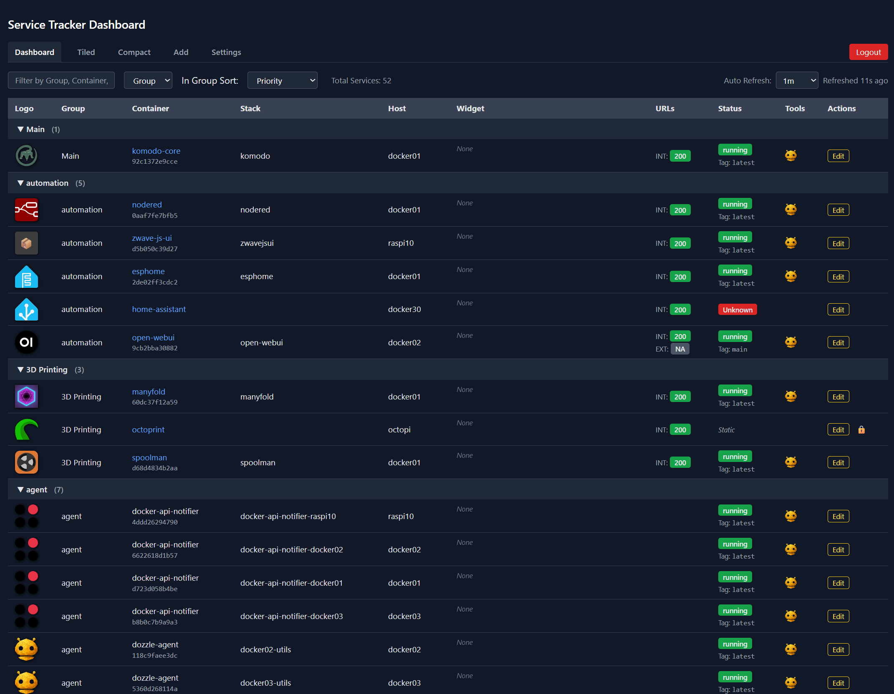
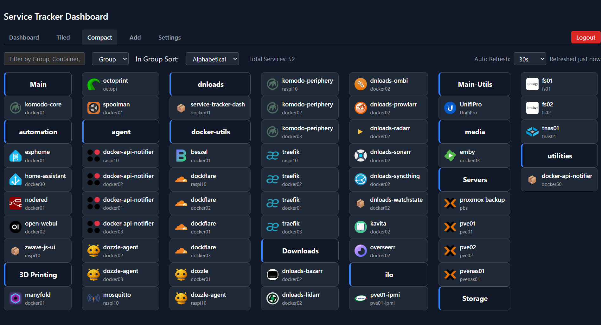
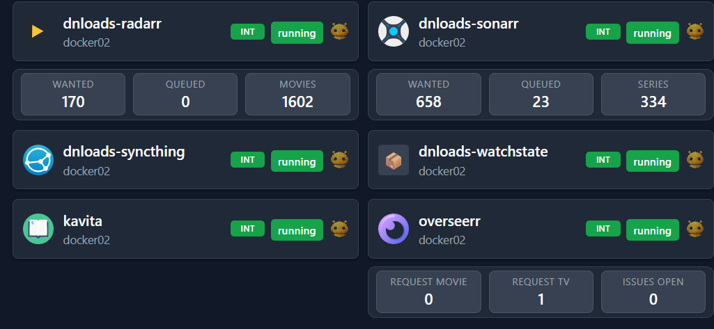

# 🧭 Service Tracker Dashboard (STD)


A homelab-scale Flask dashboard that tracks Docker services across multiple
hosts, runs background URL health checks, and renders a small set of
dashboard views (full, tiled, compact). Service entries are populated and
kept current by a sidecar process — typically
[docker-api-notifier](https://github.com/crzykidd/docker-api-notifier) —
posting to STD's register endpoint, but you can also add entries by hand
through the web UI or directly via API.

> **Compatibility:** STD v0.6.0+ requires `docker-api-notifier` v0.3.0+
> (`/api/v1/register` only). Network, port, and exposure data needs
> notifier v0.4.0+.

---

## Table of Contents

1. [What's New](#whats-new)
2. [What It Does](#what-it-does)
3. [Screenshots](#screenshots)
4. [Configuration](#configuration)
5. [Docker Compose Setup](#docker-compose-setup)
   - [Moving from Docker Hub](#moving-from-docker-hub)
6. [Database Migrations](#database-migrations)
7. [API: Registering Services](#api-registering-services)
8. [Management API](#management-api)
9. [Managing STD with Claude](#managing-std-with-claude)
10. [Notifications](#notifications)
11. [Container Labels (via docker-api-notifier)](#container-labels-via-docker-api-notifier)
12. [Files and Paths](#files-and-paths)
13. [Health Checks](#health-checks)
14. [Routes](#routes)
15. [Widgets](#widgets)
16. [Behavior Notes](#behavior-notes)
17. [Versioning & Releases](#versioning--releases)
18. [Development](#development)

---

## What's New

### v0.10.1 (2026-11-20)

Inventory streams you can watch: a dead sidecar or a removed reservation no
longer goes unnoticed. One database migration runs on startup (five stream
columns and `inventory_missing_since` on entries); no notifier change is
needed. API revision 3: sidecars may now advertise their snapshot interval.

- **Stale streams:** an enabled stream with no snapshot for twice its expected
  interval (yours, else the sidecar's, else 15 minutes) shows a red badge in
  Settings → Streams and on the Settings link, a `down` line in the health
  summary, `stale` on MQTT and a **Problem** sensor in Home Assistant. Its
  entries keep their own health.
- **Rejected snapshots:** the stream row shows when and why STD refused a
  sidecar's snapshot.
- **Missing since:** an entry that dropped out of its snapshot gets an amber
  badge with how long ago; its checks still decide its health. Optionally,
  soft delete entries missing for N days (off by default; entries you edited
  are never removed).
- **Checks follow a changed IP:** ping, TCP, DNS and HTTP checks on the old IP
  move to the new one when the stream reports it.
- **MCP `server_info`** re-checks STD's version on every call and tells you
  when to restart or update the MCP server.

### v0.10.0 (2026-11-19)

Notifications to MQTT and Home Assistant, inventory streams that push device
lists into STD, and the running version in the header. Five database
migrations run on startup (notification channels, Home Assistant opt-outs,
inventory streams, stream default checks, linked stream entries); no notifier
change is needed.

- **Version in the header:** the running version next to the page title, with
  a What's New link and an **Update available** link when GitHub has a newer
  release (the check can be turned off in Settings → About).
- **MQTT notifications:** Settings → Notifications adds MQTT channels that
  publish retained entry, check and summary state, with a test message button.
  Deleting, disabling or re-basing a channel can clean its broker, and **Scan
  for orphans** finds leftover topics.
- **Home Assistant discovery:** tick **Add to Home Assistant** on a channel and
  pick entries; each gets a device with State, Since and per-check sensors.
  Purge tools give a clean slate per channel, entry or stream.
- **Inventory streams:** a sidecar (such as `std-source-technitium` for DHCP
  reservations) pushes a full device list with an `ingest` API key. New streams
  wait for review in Settings → Streams (flagged on the Settings link), with
  Preview, Enable, network filters, a block list, and offers to link items to
  your existing manual entries. Linked entries are never deleted by stream
  cleanup, and a stream can give its entries default ping / TCP checks.
- **Stream entries in the views:** a stream pill on the Dashboard, a small
  router icon on Tiled and Compact (Compact now shows a source icon on every
  row), a "missing from latest snapshot" marker, and IP, MAC and network in
  the expanded detail.
- **API revision 2:** `X-STD-API-Revision` and `X-STD-Version` headers and a
  public `GET /api/v1/meta`; every new feature is in the management API and
  the MCP server.
- **Nightly database snapshot** next to the YAML backup, pruned with it.
- **Fixed:** auto-refresh now runs only on the Dashboard, Tiled and Compact
  views.

### v0.9.0 (2026-11-16)

New check types, clearer health, and a Tiled view that's easier to read.
Three database migrations run on startup (DNS check columns, certificate
columns, API key rotation); no notifier change is needed.

- **DNS service check:** query a given DNS server for a name and record type,
  expect an rcode and optionally an answer (`rcode NXDOMAIN`,
  `answer 10.0.0.5, expected 10.100.17.10`).
- **Certificate expiry on HTTPS checks:** optional **Min cert days**; works
  with Verify TLS off, and the detail panel shows the expiry date.
- **Clearer health:** a running container no longer softens failing URL or
  service checks to Degraded; HTTP failures show the reply's reason
  (`503: <last_error>`) in Status and Body mode; degraded and down entries get
  a soft amber or red background on every view.
- **Tiled view redesign:** names use the full tile width, the host shows under
  the name when the name isn't unique (`tile_show_host`), and all icons sit in
  one row along the bottom. Exposure icons show once per proxy.
- **API keys:** rotate a key from Settings → API keys; a revoked key's name can be
  reused.
- **Settings → Groups:** one Save for the whole table, with a warning before
  leaving unsaved changes. Fixes the per-row Save clearing a group's priority.
- **MCP server:** installs with one `uv run` command and warns when it doesn't
  match your STD version; `whoami` now reports the STD version.

### v0.8.0 (2026-11-15)

A management API so scripts and agents such as Claude can maintain STD. One
database migration runs on startup (API key and audit tables); no notifier
change is needed. **Not fully tested yet:** the API and MCP server pass the
automated suite but haven't been fully tested against real instances, so start
with a read key and keep a recent backup.

- **Admin API keys** in Settings → API keys: named, **read** or **write**, shown
  once, revocable, with last-used time and IP. They are separate from the
  notifier's `api_token`, which stays register-only.
- **REST API under `/api/v1`** for everything the UI does: entries (list with
  filters, create manual sites with checks, edit, delete, restore), checks
  (add, edit, delete, run now), health history and a one-call
  `/health/summary` of everything failing, groups, widgets (keys never
  returned), exposure settings and a read-only, secret-masked config view.
- **OpenAPI spec** at `/api/v1/openapi.json` and a **write audit log** in
  Settings → Audit log (every change, by key, secrets masked).
- **MCP server** (`mcp/`, runs on your machine, not in the image) so Claude
  Code or Claude Desktop can manage STD as tools.
- **Fixed:** leaving the group blank on the Add page no longer creates a group
  named "None".

### v0.7.1 (2026-11-15)

Two dashboard conveniences on top of 0.7.0. No migrations, no configuration
change.

- **Clickable Total / Passing / Failing counts** replace "Total Services" in
  the filter bar. Click one to filter the view to it; the active count is
  highlighted.
- **"Show uptime" checkbox** in the filter bar adds a compact 24-hour uptime
  strip (48 half-hour bars plus the uptime %) to every service on Dashboard,
  Tiled and Compact. Off by default and remembered in a browser cookie; hover
  or tap a bar for the failure messages.

### v0.7.0 (2026-11-15)

Dashboard and monitoring. STD is now a dashboard for Docker containers **and**
anything else you run, with simple Gatus-style health monitoring. No notifier
upgrade is needed. Four database migrations run on startup; back up
`/config/services.db` first.

- **Manual entries are first-class.** Non-Docker sites (router, NAS, SaaS)
  are added on the Add page with a Name, optional Host and a Description,
  shown as "Manual" and never flagged stale. A container that later registers
  with the same host and name adopts the entry. "Locked" is now just "Lock
  (ignore notifier updates)".
- **Health checks.** Each entry has an Internal URL check, an External URL
  check, an automatic **Container** check (Docker entries: passes while the
  notifier reports it running) and any number of service checks: HTTP/HTTPS
  (status code, or body mode where `OK` passes and `Error: <message>` fails
  with that message), TCP (`host:port`), Ping and DNS (ask a DNS server for a
  name and check the reply). HTTPS checks can also fail when the certificate
  is close to expiry. Each has its own interval
  and timeout, set in one "Health checks" section on Add and Edit.
- **Concurrent checker with a week of history.** Checks run in parallel
  (`health_check_workers`, default 8). Every sample is kept for 24 hours, then
  successes are merged hourly while failures are kept; history is kept for 7
  days (`health_raw_hours`, `health_history_days`).
- **One health badge per service** (Up, Degraded, Down, Unknown, Not
  monitored) on every view, and **Status / Source filters** in the filter bar.
  Degraded and down entries also get a soft amber or red background (and a
  thin colored edge) on the Dashboard, Tiled and Compact views.
- **Health detail panel** in the Tiled drawer, a Dashboard expand row and the
  Edit page: per-check state, uptime for 24h and 7d, recent failures, a
  24h / 7d bar strip with tooltips, and **Check now**.
- **Add and Edit show their messages** inline.
- **Show uptime** (added in v0.7.1): a filter-bar checkbox, remembered in a cookie,
  that adds a 24-hour uptime strip (48 half-hour bars and the uptime %) to
  every service on Dashboard, Tiled and Compact.

### v0.6.9 (2026-11-15)

A hardening and safety-net release. **Read before upgrading:** if you never
set `API_TOKEN`, registers now return 503 until you do, and browser tabs left
open across the upgrade need a reload before their next form submit or delete.

- **Deletes are recoverable.** Deleted services go to the new Settings ->
  Deleted tab for `deleted_retention_days` (default 30) before they are purged.
  A container that registers again before then comes back with its group,
  sort priority, and edits intact. Permanently deleting a service keeps its
  widget as a detached widget you can re-attach.
- **Stale indicator on every view**, driven by one `stale_after_minutes`
  setting (default 5).
- **Per-service health-check options:** a timeout and a "Verify TLS
  certificate" switch for self-signed internal URLs, plus a global
  `health_check_timeout` setting.
- **Fixed:** `widget_value_retention_days` and `register_field_ownership` were
  silently ignored and now work; an unset `API_TOKEN` no longer accepts a bogus
  header.
- **Security:** CSRF protection on every form and in-page request, a
  constant-time token check, the token masked in logs, warnings when the
  default secret key or admin password is still in use, and icon, backup and
  widget paths and post-save redirects confined to STD.
- **Runtime:** the image now runs gunicorn (one worker) with pinned
  dependencies. No configuration change is needed.

### v0.6.8 (2026-11-15)

GHCR is now the only registry -- Docker Hub images are no longer published.
If you still pull `crzykidd/service-tracker-dashboard` from Docker Hub you
are frozen on v0.6.7; switch to `ghcr.io/crzykidd/service-tracker-dashboard`
(see [Moving from Docker Hub](#moving-from-docker-hub)).

- `:dev` and `:latest` images now show the real version number in
  Settings → About, and the What's New popup works on them.
- Fixed: the Add page no longer returns a server error when Sort Priority
  isn't a number, and the group dropdown stays populated when the form
  re-displays after a validation error.
- The "moved to GHCR" banner from the v0.6.7 Docker Hub image is removed.

### v0.6.7 (2026-11-15)

STD now publishes to GitHub Container Registry (GHCR). If you pull
`crzykidd/service-tracker-dashboard` from Docker Hub, change your image to
`ghcr.io/crzykidd/service-tracker-dashboard` -- this is the last release
published to Docker Hub. Switching is a one-line image change in your
compose file; your config, database, and settings carry over unchanged. See
[Moving from Docker Hub](#moving-from-docker-hub).

- Same tags as before on GHCR: `:latest`, `:dev`, `:<version>`, `:<major>`.
- Installs still running the Docker Hub image show a "moved to GHCR" banner
  on every page (dismissible per browser session) and a note on Settings
  -> Service Info. The GHCR image does not show it.

---

## What It Does

- Three dashboard views (table, tiled, compact). Tiled view shows each service as a tile: the icon on the left, the name across the full tile width (with the host in small text underneath when the same name exists on another host, per `tile_show_host`), and one row along the bottom with the status icons, the exposure badges and the actions with a per-tile expand drawer for full host, URL, Docker, network, port, exposure, and widget detail. Icons use [Tabler Icons](https://tabler.io/icons) v3.34.0 (loaded via CDN). Clicking the chart icon on a tile opens the drawer in widget-only mode (showing just the metric cards); the chevron opens the full drawer. The two modes switch in-place without closing and reopening.
- **Stale indicator.** A dynamic service whose last notifier update is older than `stale_after_minutes` (default 5) shows an amber warning icon with a "Stale — updated <time>" tooltip on all three views. Manual and locked entries are never flagged.
- **Dashboard view controls (v0.6.0+).** A `Group by` axis selector
  (`group` / `stack` / `host`) and a `Show URL-less` filter render
  above the service grid on all three views. State is URL-driven, so
  dashboards stay bookmarkable.
- Internal + external URL health checks on a configurable interval.
- **Health badge and filters.** One rolled-up health state per entry (up,
  degraded, down, unknown, not monitored) on all three views, and `Status`
  (`all` / `failing` / `healthy` / `unknown` / `stale`) and `Source`
  (`all` / `notifier` / `manual`) filters next to `Group by`, kept in the URL
  (`?status=failing&source=manual`). The filter bar shows clickable
  **Total**, **Passing** and **Failing** counts that apply the matching
  Status filter (they follow Source and Show URL-less, not Status).
- **Show uptime** checkbox: when ticked, every service shows an inline 24h
  uptime strip. Off by default; remembered in the `std_show_uptime` browser
  cookie rather than the URL, and nothing is fetched while it is off.
- Auto-downloads container icons from
  [Homarr Labs Dashboard Icons](https://github.com/homarr-labs/dashboard-icons).
- Register endpoint for pushing container metadata from external tools.
- SQLite backing store, file-based, no external DB server.
- Daily YAML backups and SQLite snapshots with retention.
- Manual entries: the Add page creates non-Docker entries (Name, optional Host, Description, URLs, group, icon). They show a link icon (Tiled) or "Manual" pill (Dashboard) instead of Docker status and are never stale. If the notifier later registers the same host and name, it takes the entry over. Tiled tiles and Dashboard rows have a one-click trash icon with an inline confirm popover. Locked entries show a lock icon and can only be deleted from the edit page. Deletes are recoverable from Settings → Deleted.
- Optional Dozzle log link integration.
- Local user accounts with session-based auth.
- Per-entry sort priority within groups; grouping and group sort.
- Pluggable widget system (Sonarr, Radarr, Bazarr, Overseerr, Prowlarr,
  Syncthing today; more under `widgets/`).
- **Exposure interpreter (v0.6.0+).** Reads structured exposure
  observations from the notifier's YAML interpreters (Traefik,
  Dockflare, etc.) and synthesizes `internalurl` / `externalurl`
  without requiring operator-written `dockernotifier.std.*` labels.
  Operator UI edits and explicit labels always win over synthesized
  values.

---

## Screenshots

<!-- TODO(v0.6.1): Still outstanding as of v0.6.9. Screenshots below predate the v0.6.1 tile redesign (host line removed from tile face, icon-row status strip, expand drawer replacing inline widget data, Tabler icons replacing emoji badges). Refresh before next public announcement. -->

| Main Dashboard | Tiled View | Compact View |
|---|---|---|
| [](docs/screenshots/std_main_dashboard.png) | [](docs/screenshots/std_tile_dashboard.png) | [](docs/screenshots/std_compact_dashboard.png) |

| Mobile View | Widgets | Settings |
|---|---|---|
| [](docs/screenshots/std_mobile.png) | [](docs/screenshots/std_widgets.png) | [](docs/screenshots/std_settings.png) |

---

## Configuration

STD reads config from environment variables and an optional
`/config/settings.yml`. Environment variables take priority. If
`settings.yml` is missing, defaults apply and a `settings.example.yml`
is dropped into `/config` for reference.

Default login: `admin` / `changeme123`. Change it on first run.

### Version and update check

The running version shows next to the page title on every page; click it for
the What's New popup. Release images show `v0.9.0`; `:dev` and local builds
show `dev · 0.9.0+sha-abc1234` with the short commit linked to GitHub. When
GitHub has a newer **release**, a subtle `update available → vX.Y.Z` link
appears.

The check runs inside STD (your browser never calls GitHub), only when someone
loads a page, at most once per interval, and never delays a page. It sends no
credentials or personal data. Change it in **Settings → About** (or
`PUT /api/v1/settings/update-check`):

| Setting | Default | What it does |
|---|---|---|
| `update_check_enabled` | on | Off means STD makes no request to GitHub and shows no update link (Settings → About says "Update check disabled"). |
| `update_check_interval_hours` | `6` | Hours between checks (minimum 1). After an error STD keeps the last known result and backs off up to 24 hours. |

### Settings reference

| Setting                    | Type   | ENV                          | Default            | What it does |
|----------------------------|--------|------------------------------|--------------------|--------------|
| `api_token`                | string | `API_TOKEN`                  | —                  | Bearer token required by `/api/v1/register`. If unset, register returns 503 until it is set. The token is masked in logs. |
| `std_dozzle_url`           | string | `STD_DOZZLE_URL`             | —                  | Optional link to a Dozzle instance; enables a Tools section in the UI. |
| `backup_path`              | string | `BACKUP_PATH`                | `/config/backups`  | Where backups (YAML and SQLite snapshots) are written. |
| `backup_days_to_keep`      | int    | `BACKUP_DAYS_TO_KEEP`        | `7`                | Backup retention. |
| `url_healthcheck_interval` | int    | `URL_HEALTHCHECK_INTERVAL`   | `300`              | Seconds between health check passes. |
| `health_check_timeout`     | int    | `HEALTH_CHECK_TIMEOUT`       | `5`                | Seconds a URL health check waits before failing. Each service can override it on its edit page (1-60). |
| `health_check_workers`     | int    | `HEALTH_CHECK_WORKERS`       | `8`                | How many health checks run at the same time. |
| `health_raw_hours`         | int    | `HEALTH_RAW_HOURS`           | `24`               | Hours every health-check sample is kept individually. Older successes are merged into one row per unbroken run per clock hour (failures are always kept); an hourly job at :05 does this. |
| `health_history_days`      | int    | `HEALTH_HISTORY_DAYS`        | `7`                | Days of health-check history kept; an hourly job at :03 deletes older rows. |
| `api_audit_retention_days` | int    | `API_AUDIT_RETENTION_DAYS`   | `90`               | Days the management-API write audit log is kept; a daily 00:35 job deletes older rows. |
| `widget_background_reload` | int    | `WIDGET_BACKGROUND_RELOAD`   | `900`              | Seconds between widget data refreshes. |
| `widget_value_retention_days` | int | `WIDGET_VALUE_RETENTION_DAYS` | `30`            | Days of `widget_value` history to retain. A daily 00:15 background job prunes older rows. |
| `deleted_retention_days`   | int    | `DELETED_RETENTION_DAYS`     | `30`               | Days a deleted service stays recoverable in Settings → Deleted before a daily 00:25 job removes it permanently. `0` purges at the next run. |
| `stale_after_minutes`      | int    | `STALE_AFTER_MINUTES`        | `5`                | Minutes without a notifier update before a dynamic service is flagged stale (warning icon on the Dashboard, Tiled, and Compact views). Manual and locked entries are never stale; the notifier re-scans every 60 s by default. |
| `tile_show_host`           | string | `TILE_SHOW_HOST`             | `duplicates`       | Show the host under the name on Tiled tiles and after it on Compact rows: `duplicates` (only where the same name exists on another host), `always` (every entry with a host) or `never`. |
| `register_field_ownership` | string | `REGISTER_FIELD_OWNERSHIP`   | `user_wins`        | How register calls handle conflicts with UI edits on `group_name` and `sort_priority`. `user_wins` (default) preserves non-NULL UI values on update; `notifier_wins` always overwrites. Invalid values fall back to `user_wins` with a startup warning. |
| `user_session_length`      | int    | `USER_SESSION_LENGTH`        | `120`              | User session length in minutes. |
| `flask_secret_key`         | string | `FLASK_SECRET_KEY`           | —                  | Required for production. Used to sign session cookies. If unset, a built-in default is used and Settings shows a warning (as it does while `admin` still has the default password). |

### Example `settings.yml`

```yaml
api_token: supersecrettoken
std_dozzle_url: http://dozzle.local
backup_path: /config/backups
backup_days_to_keep: 7
url_healthcheck_interval: 300
health_check_timeout: 5
health_check_workers: 8
health_raw_hours: 24
health_history_days: 7
api_audit_retention_days: 90
widget_background_reload: 900
widget_value_retention_days: 30
register_field_ownership: user_wins
stale_after_minutes: 5
tile_show_host: duplicates
user_session_length: 120
```

---

## Docker Compose Setup

```yaml
services:
  service-tracker-dashboard:
    image: ghcr.io/crzykidd/service-tracker-dashboard:latest
    container_name: service-tracker-dashboard
    ports:
      - 8815:8815
    environment:
      - API_TOKEN=supersecrettoken
      - STD_DOZZLE_URL=http://dozzle.local
      - FLASK_DEBUG=0
      - FLASK_SECRET_KEY=changeme-in-prod
    volumes:
      - ./config:/config
    restart: unless-stopped
```

### Moving from Docker Hub

STD images are published to **GitHub Container Registry (GHCR)** only.
Docker Hub images (`crzykidd/service-tracker-dashboard`) are no longer
published; **v0.6.7 was the last one** and it will not receive further
updates.

To move, change one line in your compose file:

```diff
-    image: crzykidd/service-tracker-dashboard:latest
+    image: ghcr.io/crzykidd/service-tracker-dashboard:latest
```

Then pull and recreate:

```bash
docker compose pull
docker compose up -d
```

Nothing else changes: the tags are the same (`:latest`, `:dev`,
`:<version>`, `:<major>`), and your `/config` volume, database, and
settings carry over as-is. If you pin a version, use the same tag on
GHCR (e.g. `ghcr.io/crzykidd/service-tracker-dashboard:0.6.7`).
Docker Hub images stop at v0.6.7; GHCR is the only registry from v0.6.8 on.

---

## Database Migrations

Schema changes are tracked with [Alembic](https://alembic.sqlalchemy.org/).
Migrations live in `alembic/versions/` and `alembic upgrade head` runs
automatically on container start (see `entrypoint.sh`).

To create a new migration after changing models, exec into a running
container:

```bash
docker compose exec <service-name> \
  alembic revision --autogenerate -m "describe the change"
```

The new revision file lands under `alembic/versions/`. Review it before
committing — autogenerate doesn't catch every kind of change
(constraint renames, default-only changes, SQLite-specific quirks).

To check whether models and the live database have diverged without
writing a migration:

```bash
docker compose exec <service-name> alembic check
```

---

## API: Registering Services

`/api/v1/register` is the only register endpoint. The legacy
`/api/register` shim that bridged v0.4.x producers through v0.5.0
was removed in v0.6.0; producers must run `docker-api-notifier`
v0.3.0+ or send canonical-key payloads directly.

### Endpoint

```
POST /api/v1/register
Authorization: Bearer <API_TOKEN>
Content-Type: application/json
```

### Canonical payload

```json
{
  "host": "docker01",
  "container_name": "nginx",
  "container_id": "abc123...",
  "image_name": "ghcr.io/user/nginx:latest",
  "image_icon": "nginx.svg",
  "docker_status": "running",
  "stack_name": "frontend",
  "started_at": "2026-05-10T12:34:56Z",
  "timestamp": "2026-05-10T12:35:00Z",
  "internalurl": "http://nginx:80",
  "externalurl": "https://my.domain.com",
  "internal_health_check_enabled": true,
  "external_health_check_enabled": true,
  "group_name": "web",
  "sort_priority": 1,
  "networks": [
    {"name": "proxy", "aliases": ["frontend"]},
    {"name": "ammoledger_default", "aliases": ["frontend"]}
  ],
  "exposed_ports": ["5173/tcp"],
  "published_ports": [
    {"container_port": 5173, "protocol": "tcp",
     "host_ip": "0.0.0.0", "host_port": 8080}
  ],
  "exposure_observations": [
    {"layer": "traefik", "hostname": "nginx.internal.example",
     "tls": true, "path_prefix": null, "auth": null, "details": null},
    {"layer": "dockflare", "hostname": "nginx.example.com",
     "tls": true, "path_prefix": null,
     "auth": "cloudflare_access:authenticate", "details": null}
  ]
}
```

### Required fields

- `host` — Docker host name. Composite key with `container_name`.
- `container_name` — name of the container.

Everything else is optional. STD applies sensible defaults for any
field that's missing.

`/api/v1/register` is **strict** — unknown keys are rejected with a
400 and the list of offending keys in the response body. Nested
structures (`networks`, `published_ports`) are also validated via
pydantic; malformed entries are rejected at the schema boundary.

### Field ownership: user_wins vs notifier_wins

`group_name` and `sort_priority` can be edited in the web UI. When a
notifier register arrives for a row whose UI value differs, the
`register_field_ownership` setting decides who wins:

- **`user_wins`** (default) — UI edits stick. The notifier may
  populate these fields on a new row or one where they're still
  NULL, but it won't overwrite a value the operator has set.
- **`notifier_wins`** — every register call overwrites everything,
  including UI edits. Choose this if your container labels are the
  source of truth.

Regardless of mode, STD records what the notifier sent in
`notifier_reported_group_name` and `notifier_reported_sort_priority`
columns. These columns aren't surfaced in the UI yet — they support
a planned overridden-labels export.

### Network and ports capture (v0.6.0+)

The three optional `networks` / `exposed_ports` / `published_ports`
fields are pure observation — STD overwrites them on every register
call with no ownership semantics. They're populated by
`docker-api-notifier` v0.4.0+; pre-v0.4.0 notifiers continue to work
and just leave the columns NULL.

The read-only "Reported by notifier" block at the bottom of
`/edit/<id>` surfaces this data. Empty / NULL columns render as "Not
reported." Manual entries (added through the UI) have no such block and won't
have this data, and that's expected.

### Exposure observations + URL synthesis (v0.6.0+)

The optional `exposure_observations` field carries structured output
from the notifier's YAML interpreters (Traefik, Dockflare, …).
Notifier v0.4.0+ runs these interpreters and emits one entry per
interpreter that recognizes the container. STD writes them into the
new `service_exposure` table and runs a synthesizer that may
populate `internalurl` / `externalurl` automatically.

Operators tell STD what each layer means at `/settings` →
**Docker**. Each discovered layer (only layers that have been
observed appear) gets a direction dropdown:

- **internal** — synthesized hostname populates `internalurl`.
- **external** — synthesized hostname populates `externalurl`.
- **neither** (default) — STD records the observation and shows a
  badge, but doesn't synthesize a URL from this layer.

Per-host overrides let you say "Traefik on the home host is
internal, but Traefik on the edge VPS is external" without writing
different YAML per host.

#### URL provenance

The two `internalurl` / `externalurl` columns now track who last
wrote them via two new `_source` columns. Ordering, strongest last:

1. **NULL** — no value, no opinion. Synthesizer is free to fill in.
2. **`synthesized`** — value came from the synthesizer. Re-runs on
   every register and on settings save may change it.
3. **`explicit_label`** — value came from a
   `dockernotifier.std.internalurl` / `.externalurl` label on the
   container. Synthesizer won't overwrite. A new explicit label
   updates it; a UI edit overrides.
4. **`ui_edit`** — operator typed a value in the web UI. Nothing
   overrides until another UI edit. Clearing the field resets the
   source to NULL so synthesis can resume.

The edit page (`/edit/<id>`) shows a small badge next to each URL
indicating the current source.

#### Wire-level semantics

- `exposure_observations` **absent** or **null** — "no update."
  Existing exposure rows for the service are preserved. This is the
  state for pre-v0.4.0 notifiers and any producer that doesn't emit
  interpreter output.
- `exposure_observations: []` — "this container has no interpreter
  matches." All existing exposure rows for the service are
  cleared. The synthesizer may then clear any URL whose source is
  `synthesized`.
- `exposure_observations: [ ... ]` — wholesale replacement. All
  prior rows for this service are dropped, the new rows are
  inserted, and the synthesizer recomputes URLs (respecting
  provenance).

#### Badges and headless rendering

Each tile (tiled view) and row (table view) renders up to three
exposure badges, one brand logo per proxy layer (Traefik, Cloudflare, …)
however many routes it has. Hover a logo for the route count and each
route's hostname, TLS and auth. A `+N` overflow badge appears when a
service is observed by more than three layers.

Services with no exposure observations **and** no URLs (manual,
explicit, or synthesized) are considered "headless." Their tiles
render without click affordance and rely on `docker_status` for
state. Combine with the `?show_urlless=false` view-control filter
(v0.6.0) to hide them entirely.

---

## Management API

> **Not fully tested yet.** The management API and the MCP server are new in
> v0.8.0. They pass the automated test suite but have not been fully tested
> against real instances. Start with a **read** key, check the audit log in
> Settings → Audit log after any writes, and keep a recent backup before letting an
> agent make changes.

Everything you can do in the web UI can also be done over JSON, so a script or
an agent such as Claude can maintain an instance: read every entry and its
health, add manual sites and web checks, edit fields, move entries between
groups, attach widgets, change exposure settings and triage failures. It is
separate from [`/api/v1/register`](#api-registering-services), which stays
exactly as it was.

The machine-readable description is an OpenAPI 3.1 document at
`GET /api/v1/openapi.json` (no key needed; it describes shapes, not data). It
is generated from the same declarations the tests check against the routes, so
it always matches the code.

### API revision

The `/api/v1` contract has its own revision number, separate from the STD
version. Every response under `/api/` (errors included) carries
`X-STD-API-Revision: <n>` and `X-STD-Version: <x.y.z>` headers.
`GET /api/v1/meta` needs no key and returns
`{"std_version", "api_revision", "features"}`; scripts and producers can call
it at startup to log what this STD speaks. `whoami` also reports
`api_revision`, the OpenAPI `info` has `x-api-revision`, and the MCP
`server_info` tool reports `std_api_revision`. STD logs each distinct
`User-Agent` it sees on `/api/v1/register` once per restart, so give your
producer a `User-Agent: name/version`.

### Create a key and send it

1. Open **Settings → API keys**, enter a name and pick a scope, and press
   **Create key**.
   - **read** can read everything (entries, checks, health, groups, widgets,
     settings, the masked config).
   - **write** can read and change.
   - Use a read key for dashboards and monitoring, and a write key only for
     things that should change STD.
   - **ingest** (for inventory sidecars) opens only the two
     [stream ingest](#inventory-streams-and-sidecars) routes. It cannot read or
     change anything else. Pick **Ingest (sidecars)** in the scope list and
     create one key per sidecar.
2. Copy the key now. It is shown **once** (`std_<prefix>_<secret>`); only a
   hash is stored. A lost key is revoked and replaced.
3. Send it on every request:

```bash
export STD=http://localhost:8815      # your STD base URL
export KEY=std_xxxxxxxx_...           # the key you just created
curl -s -H "Authorization: Bearer $KEY" "$STD/api/v1/whoami"
# {"name":"agent","prefix":"ba45c874","scope":"write"}
```

The notifier's `api_token` is **register-only**: it cannot call any of these
endpoints, and a management key is rejected by `/api/v1/register`. Browser
sessions do not authenticate the management API either, so it needs no CSRF
token.

### Endpoints

| Method | Path | Scope | What it does |
|---|---|---|---|
| GET | `/api/v1/openapi.json` | none | This OpenAPI document |
| GET | `/api/v1/meta` | none | STD version, API revision and supported features |
| GET | `/api/v1/whoami` | read | Name, prefix and scope of the calling key |
| GET | `/api/v1/entries` | read | List entries |
| POST | `/api/v1/entries` | write | Add a manual entry |
| GET | `/api/v1/entries/{id}` | read | Get one entry in full |
| PATCH | `/api/v1/entries/{id}` | write | Edit an entry |
| DELETE | `/api/v1/entries/{id}` | write | Delete an entry (soft) or remove it for good |
| POST | `/api/v1/entries/{id}/unlink` | write | Unlink a stream entry (back to a manual entry) |
| POST | `/api/v1/entries/{id}/restore` | write | Restore a deleted entry |
| GET | `/api/v1/entries/{id}/checks` | read | List an entry's checks |
| POST | `/api/v1/entries/{id}/checks` | write | Add a service check |
| PATCH | `/api/v1/checks/{id}` | write | Edit or enable/disable a check |
| DELETE | `/api/v1/checks/{id}` | write | Delete a service check |
| POST | `/api/v1/entries/{id}/checks/run` | write | Check now |
| GET | `/api/v1/entries/{id}/health` | read | Health history of an entry |
| GET | `/api/v1/health/summary` | read | Counts and the failing entries |
| GET | `/api/v1/groups` | read | List groups |
| POST | `/api/v1/groups` | write | Create a group |
| PATCH | `/api/v1/groups/{id}` | write | Rename or edit a group |
| DELETE | `/api/v1/groups/{id}` | write | Delete a group |
| GET | `/api/v1/widgets/types` | read | Widget types and their fields |
| GET | `/api/v1/widgets` | read | List widget instances |
| PUT | `/api/v1/entries/{id}/widget` | write | Attach or reconfigure an entry's widget |
| DELETE | `/api/v1/entries/{id}/widget` | write | Detach an entry's widget |
| DELETE | `/api/v1/widgets/{id}` | write | Delete a detached widget |
| GET | `/api/v1/settings/exposure` | read | Exposure direction settings |
| PUT | `/api/v1/settings/exposure` | write | Replace exposure direction settings |
| GET | `/api/v1/settings/update-check` | read | Update check settings |
| PUT | `/api/v1/settings/update-check` | write | Change the update check settings |
| GET | `/api/v1/notifications/channels` | read | List notification channels |
| POST | `/api/v1/notifications/channels` | write | Add a notification channel |
| GET | `/api/v1/notifications/channels/{id}` | read | Get a notification channel |
| PATCH | `/api/v1/notifications/channels/{id}` | write | Edit a notification channel |
| DELETE | `/api/v1/notifications/channels/{id}` | write | Delete a notification channel (`cleanup`, default true, clears its broker data first) |
| POST | `/api/v1/notifications/channels/{id}/test` | write | Send a test message through a channel |
| POST | `/api/v1/notifications/channels/{id}/purge` | write | Purge a channel's retained MQTT topics and Home Assistant devices |
| GET | `/api/v1/notifications/channels/{id}/previous-bases` | read | List the base topics a channel used before |
| POST | `/api/v1/notifications/channels/{id}/orphans/scan` | write | Scan a channel's broker for orphaned retained STD topics |
| POST | `/api/v1/notifications/channels/{id}/orphans/clear` | write | Clear orphaned retained topics |
| POST | `/api/v1/entries/{id}/notifications/purge` | write | Purge an entry's MQTT topics and Home Assistant device, then republish it |
| PUT | `/api/v1/streams/{stream_id}/snapshot` | ingest | Push a full inventory snapshot (sidecars) |
| GET | `/api/v1/streams/{stream_id}/status` | ingest | A stream's status, for a sidecar to log |
| GET | `/api/v1/streams` | read | List inventory streams |
| GET | `/api/v1/streams/{stream_id}` | read | Get one stream |
| PATCH | `/api/v1/streams/{stream_id}` | write | Rename a stream or change its filters and default checks |
| POST | `/api/v1/streams/{stream_id}/default-checks/apply` | write | Add the stream's default checks to its existing entries |
| POST | `/api/v1/streams/{stream_id}/notifications/purge` | write | Purge a stream's entries' MQTT topics and Home Assistant devices, then republish |
| GET | `/api/v1/streams/{stream_id}/preview` | read | What applying the stored snapshot would do |
| POST | `/api/v1/streams/{stream_id}/enable` | write | Enable a stream and apply its stored snapshot |
| POST | `/api/v1/streams/{stream_id}/disable` | write | Disable a stream (`cleanup`: keep, soft_delete, purge) |
| POST | `/api/v1/streams/{stream_id}/ignore` | write | Ignore a pending or disabled stream |
| DELETE | `/api/v1/streams/{stream_id}` | write | Delete a stream (`?cleanup=`) |
| GET | `/api/v1/streams/{stream_id}/blocks` | read | List a stream's blocked keys |
| DELETE | `/api/v1/streams/{stream_id}/blocks/{block_id}` | write | Unblock a key |
| GET | `/api/v1/streams/{stream_id}/offers` | read | List open link offers |
| POST | `/api/v1/streams/{stream_id}/offers/{offer_id}/accept` | write | Accept a link offer |
| POST | `/api/v1/streams/{stream_id}/offers/{offer_id}/decline` | write | Decline a link offer |
| GET | `/api/v1/streams/{stream_id}/unmatched` | read | Items of the latest snapshot with no entry |
| POST | `/api/v1/streams/{stream_id}/link` | write | Link a manual entry to a snapshot item |
| GET | `/api/v1/config` | read | Effective configuration (read-only) |

Ids are the numeric ids shown in the API output. Write endpoints that create
something answer `201`. `PATCH` bodies take only the fields to change: a field
you leave out is untouched, and a field sent as `null` clears it where that
makes sense. Notifier-owned fields (container id, networks, ports, exposures
and so on) cannot be edited, and a request that names one is rejected. The
full request and response shapes are in the OpenAPI document.

### Examples

```bash
H=(-H "Authorization: Bearer $KEY" -H "Content-Type: application/json")

# What is failing right now? (counts plus each failing entry and why)
curl -s "${H[@]}" "$STD/api/v1/health/summary"

# Add a manual site with an HTTP check in body mode (passes when the reply is OK)
curl -s -X POST "${H[@]}" "$STD/api/v1/entries" -d '{
  "name": "Home Router", "host": "lan", "group": "Network",
  "internalurl": "http://192.168.1.1",
  "checks": [{"target": "http://192.168.1.1/healthz", "name": "Health endpoint",
              "mode": "body", "interval_seconds": 60}]
}'

# Disable a check (ids come from GET /api/v1/entries/<id>/checks)
curl -s -X PATCH "${H[@]}" "$STD/api/v1/checks/3" -d '{"enabled": false}'

# Move an entry to another group (the group is created if it is new)
curl -s -X PATCH "${H[@]}" "$STD/api/v1/entries/1" -d '{"group": "Infrastructure"}'

# Attach a widget (see GET /api/v1/widgets/types for types and fields)
curl -s -X PUT "${H[@]}" "$STD/api/v1/entries/1/widget" -d '{
  "type": "sonarr", "url": "http://sonarr:8989",
  "fields": ["wanted", "queued"], "widget_api_key": "<sonarr key>"
}'
```

### Inventory streams and sidecars

An inventory stream is a list of devices that a sidecar keeps current, for
example every static DHCP reservation. The sidecar posts the **whole** list
every few minutes; STD never pulls from your DHCP server. The first stream
sidecar is `std-source-technitium` (its own repo). Anyone can write one for
another source: the contract is [PRD §18.5](docs/PRD.md) and the OpenAPI
document.

**In the UI (Settings → Streams).**

1. Settings → **API keys**: create a key with the scope **Ingest (sidecars)** and
   give it to the sidecar.
2. The sidecar's first snapshot creates the stream as **pending**. The tab
   shows "New stream waiting: enable it to import N items" and nothing appears
   on the dashboard yet. **Preview** lists every item with what enabling would
   do (create, link offer, filtered, ...) and writes nothing.
3. **Enable** imports the items; later snapshots update them. **Ignore** drops
   a stream you don't want. The list also shows a read-only **Docker
   (register)** row with the number of notifier entries and the last register.
   While a stream is pending or disabled, **Last counts** shows what enabling
   would do ("would: created 5, link offers 2"), and the **Settings** link in
   the header carries an amber ring and count while any stream is pending
   review. A stream with no stored snapshot says "Waiting for the next
   snapshot" instead of Preview.
4. Each stream row has an **Edit** panel for its display name and its network
   include / exclude lists (applied from the next snapshot; entries already
   imported are not removed), and a **Default checks** panel: a ping check on
   each entry's IP and, optionally, a TCP check on a port. New entries of the
   stream start with them; **Apply to existing entries** adds the missing ones
   to every active entry (an entry that already has a ping or TCP check is
   skipped).
5. **Disable…** and **Delete…** open a dialog that shows the counts first, then
   asks what happens to the entries: **keep** (disable: they stay but stop
   updating; delete: they become manual entries), **soft delete** (restorable
   from Settings → Deleted) or **purge** (gone for good). The stored snapshot is
   kept when you disable, so Preview and Enable still work. Entries you
   customised (renamed, grouped, described, with an icon, checks or Home
   Assistant) are listed by name. Manual entries you linked to the stream are
   never deleted: soft delete and purge (and deleting the stream) turn them back
   into manual entries with their old host. Disable with purge can also clear the
   block list; deleting a stream always removes its blocks and link offers.
6. A stream entry's edit page has **Unlink from stream…**: the entry becomes a
   manual entry again (a linked one gets its old host back). **Allow
   re-offering** lets a later snapshot offer the link again; **Don't re-add**
   blocks the item.
7. **Staleness and missing entries** (a panel per stream): an enabled stream
   that sends nothing for **twice** its expected interval is **stale**: a red
   badge on the row ("No snapshot for 42 min (expected every 5 min)"), a red
   count on the header's Settings link, a `down` line in the health summary and a
   **Problem** sensor in Home Assistant. The interval is the one you set here,
   else the one the sidecar advertises, else 15 minutes. Its entries keep their
   own health. The same panel can **soft-delete entries missing for N days** (off
   by default; the daily cleanup job does it, and an item that comes back restores
   its entry). Entries you edited are never removed: linked, renamed, locked,
   grouped, described, with an icon, URLs, a sort priority, a widget, Home
   Assistant, or any check other than an untouched default check. A snapshot STD
   refused shows on the row as "Rejected 3 min ago: 400: ...".
8. **Blocked** lists items you deleted with "Don't re-add", with **Unblock**.
   **Link offers** lists manual entries that match a new item, with **Accept**
   and **Decline**.

Stream entries show a blue pill with the stream's name on the Dashboard view.
Tiled and Compact show a small router icon instead (green; amber when the item
dropped out of the latest snapshot); Compact shows one source icon on every row
(Docker status, stream or manual). On the Dashboard an item that dropped out of
the latest snapshot gets an amber **missing** badge with how long ago ("missing
3 days ago"); Tiled and Compact say "since" in the icon tooltip and the drawer.
It is a warning, never Down: the entry's checks still decide its health, and it
is never deleted unless you turn on the stream's missing-entry expiry (below). The
expanded detail shows a stream entry's IP, MAC and network (and "Missing ...
since").
The **Source** filter lists each stream by name (`?source=stream:dhcp`). On a
stream entry's edit page the MAC, IP, network, attributes and stream are
read-only and the name stays editable (your name then wins over the sidecar's).
Deleting one asks **Allow re-adding** (the next snapshot may bring it back) or
**Don't re-add** (it is blocked). A manual entry with an open link offer shows a
**Convert** / **Keep separate** banner on its edit page; one without an offer
offers **Link to stream item…** to pick an unmatched item by hand.

**Over the API.** The same operations, with an example:

```bash
# KEY is an `ingest` (or, for testing, a `write`) key. "dhcp" is the stream id.
curl -s -X PUT -H "Authorization: Bearer $KEY" -H "Content-Type: application/json" \
  "$STD/api/v1/streams/dhcp/snapshot" -d '{
  "display_name": "DHCP", "producer": "my-sidecar", "producer_version": "0.1.0",
  "key_type": "mac",
  "items": [
    {"key": "AA-BB-CC-00-00-01", "name": "shelly-pump", "ip": "10.0.40.21",
     "network": "IoT", "attributes": {"reservation_comment": "boiler room"}}
  ]
}'
# 202 {"stream_id":"dhcp","stream_status":"pending","applied":false,"item_count":1,"message":"..."}
```

- **A new stream is `pending`.** STD stores the snapshot (answering `202`) and
  applies nothing. Look at what it would do with
  `GET /api/v1/streams/dhcp/preview`, then
  `POST /api/v1/streams/dhcp/enable` applies the stored snapshot at once, and
  every later one as it arrives (`200` with counts of created, updated,
  unchanged, restored, missing, blocked, link offers and filtered items).
  `ignore` drops a stream you don't want.
- **What a snapshot does.** Each item becomes an entry (no host, source
  `stream`) with its IP, MAC and network. A device missing from a later
  snapshot is flagged missing, never deleted. Your edits stay: a rename of the
  entry wins over the sidecar's name, and group, icon, description, checks and
  Home Assistant settings are never written. `network_include` and
  `network_exclude` (set with `PATCH /api/v1/streams/dhcp`) leave networks out.
  Stream entries get no health checks unless the stream has
  `default_checks` (`{"ping": true, "tcp_port": 22}`, set with `PATCH` and
  applied to existing entries with `POST .../default-checks/apply`). When the
  sidecar reports a new IP, checks that pointed at the old IP (ping, TCP, DNS
  server, an HTTP URL with the IP as host) move to the new one; hostname targets
  are left alone.
- **Staleness and rejections (API revision 3).** A sidecar may add
  `"snapshot_interval_seconds": 300` to its snapshot (send it only when
  `GET /api/v1/meta` reports `api_revision` 3 or later; older STDs reject it).
  `PATCH /api/v1/streams/dhcp` takes `expected_interval_seconds` (wins over the
  sidecar's) and `missing_expiry_days`. `GET /api/v1/streams` reports `stale`,
  `stale_message`, `effective_interval_seconds`, `last_rejected_at`,
  `last_rejection`, `rejecting` and more, plus a `stale` count;
  `GET /api/v1/health/summary` adds `streams`, `stale_streams` and
  `counts.streams_stale`; entries report `inventory.missing_since`.
- **Link offers.** A new item whose name (or first DNS label) equals, ignoring
  case, exactly one active manual entry's name, host or host's first label is
  not created. It waits as a link offer: accept it
  and your entry joins the stream, keeping its id, history and checks (its host
  is cleared); decline
  it and a new entry is created.
- **Deleting a stream entry** (`DELETE /api/v1/entries/{id}?block=true`) can
  also put its key on the stream's block list, so a snapshot does not bring it
  back; unblock it with `DELETE .../blocks/{block_id}`. Without `block` the next
  snapshot that still holds the key restores it.
- **Disabling or deleting a stream** takes `cleanup`: `keep` (entries stay, no
  longer updated; deleting the stream turns them into manual entries),
  `soft_delete` (restorable from Settings → Deleted) or `purge` (gone for good).
  The stored snapshot is kept when disabling. Entries that were manual entries
  linked to the stream (`inventory.linked`) are never deleted: `soft_delete` and
  `purge` unlink them (back to manual, old host restored; counted in
  `result.unlinked`). `POST /api/v1/entries/{id}/unlink` (`{"block": bool}`) does
  the same for one entry.
- Snapshot posts are not written to the audit log; changes you make to a
  stream are. Limits: 5,000 items and 2 MiB per snapshot.

### Errors, pagination and the audit log

- **Errors** are always `{"error": "<message>", "details": ...}`. Validation
  failures are `400` and `details` is a list of `{loc, msg, type}` (or
  `{field, message}` for value rules); `401` is a missing, invalid or revoked
  key; `403` is a key whose scope is too low; `404` is an unknown id or
  endpoint; `409` is a conflict with the current state (for example deleting a
  group that still has entries, or editing a deleted entry). Requests with an
  unknown field are rejected rather than ignored.
- **Lists** return `{"items": [...], "total": N, "limit": N, "offset": N}` and
  take `?limit=` (default 200, at most 1000) and `?offset=`. `GET /entries`
  also filters by `status`, `source`, `host`, `group` and `q`, and hides
  deleted entries unless `include_deleted` or `deleted_only` is set.
- **Safety flags** on deletes: `DELETE /entries/<id>` soft-deletes (restore
  with `POST .../restore`) and `?permanent=true` removes an already deleted
  entry for good; `DELETE /groups/<id>?force=true` ungroups its entries
  instead of refusing; `DELETE /entries/<id>/widget?delete=true` also removes
  the widget.
- **Audit log.** Every write (POST, PATCH, PUT, DELETE, including rejected
  ones) is recorded with the key name, method, path, object, status and the
  changed fields as `{field: [old, new]}`. Secrets such as a widget API key
  are shown as `***`. **Settings → Audit log** lists the most recent 200
  rows and can filter by key. Rows are kept for `api_audit_retention_days`
  (default 90).

## Managing STD with Claude

> **Not fully tested yet.** The management API and the MCP server are new in
> v0.8.0. They pass the automated test suite but have not been fully tested
> against real instances. Start with a **read** key, check the audit log in
> Settings → Audit log after any writes, and keep a recent backup before letting an
> agent make changes.

You can let Claude (or any agent that can make HTTP calls) look after your
dashboard: ask it what is broken, add a new service, or tidy the groups.

1. In **Settings → API keys**, create a key named for the agent (for example
   `claude`). Use **write** if it should make changes and **read** if it should
   only look. Revoke it from the same page whenever you like.
2. Give Claude the base URL of your STD (for example `http://std.lan:8815`)
   and the key, and point it at `<base URL>/api/v1/openapi.json` so it knows
   every endpoint and body. Keep the key out of shared chats and repositories.
3. Ask in plain language. Examples:
   - "Which services are failing, and since when?"
   - "Add a manual entry for my NAS at http://nas.lan:5000 in the Storage
     group, with a ping check and an HTTP check every minute."
   - "Disable the external URL check on Jellyfin; it is behind a VPN."
   - "Move everything on host `media` into a group called Media, then show me
     the groups."
   - "Attach a Sonarr widget to the Sonarr entry using this API key."
   - "What did the `claude` key change today?" (it is in the audit log, which
     you can also read in Settings → Audit log)

### Claude Code: the MCP server

The repository's [`mcp/`](mcp/README.md) directory holds a small MCP server that
wraps these endpoints as tools (`health_summary`, `list_entries`,
`create_manual_entry`, `add_check`, `upsert_group`, `set_widget` and so on), so
Claude Code can manage STD without being told about the API. It runs on your
machine, not in the container. A **read** key gives it only the read tools; a
**write** key gives it all of them.

```bash
claude mcp add std -s user \
  -e STD_URL=http://std.lan:8815 \
  -e STD_API_KEY=std_xxxxxxxx \
  -- uv run /abs/path/to/service-tracker-dashboard/mcp/std_mcp.py
```

[uv](https://docs.astral.sh/uv/) reads the dependencies from the script itself,
so there is no virtualenv to set up. Without a checkout, point `uv run` at a
release tag instead (updating means changing the tag):
`uv run https://raw.githubusercontent.com/crzykidd/service-tracker-dashboard/v0.10.1/mcp/std_mcp.py`.
The server warns Claude when it is older or newer than your STD, and Claude can
check with the `server_info` tool, which re-checks STD's version on every call
and says when to restart the MCP server (STD was upgraded since it started) or to
update the script and restart the MCP client (the script is older than STD). A venv-based install and a Claude Desktop
example are in [`mcp/README.md`](mcp/README.md).

Then ask Claude in plain language, as in the examples above. Everything it
changes is recorded in the audit log under the key's name. Details, settings
(`STD_VERIFY_TLS`, `STD_TIMEOUT`) and the tool list are in
[`mcp/README.md`](mcp/README.md).

---

## Notifications

STD can publish to an MQTT broker (the first notification channel; state
publishing and Home Assistant discovery build on it). Configure it under **Settings → Notifications** (admins only).

1. **Add the broker.** Click **Add channel**. In the dialog: name, host, port
   (1883, or 8883 with TLS), a **base topic** (default `std`; a trailing `/`
   is dropped), and optional username and password. Under **Advanced**: a
   client id (default `std-<instance id>`), QoS (1 by default), keepalive and
   "skip certificate verification" for a self-signed broker. Turn on
   **Enabled** and save. Each channel is a card; **Edit** reopens the dialog,
   and a save that fails keeps it open with what you typed.
2. **Check it.** **Send test** (next to Save in the dialog, or in a saved
   channel's ⋯ menu) connects with the values currently in
   the form (saved or not) and publishes a JSON message to
   `<base topic>/test` (not retained). Success or the reason for the failure
   shows right next to the button (a broker that does not answer is reported within about 5 seconds). Subscribe with
   `mosquitto_sub -t 'std/#' -v` to watch.
3. **Watch the status.** Each card shows connected, connecting,
   error (with the last error) or disabled, and refreshes while the section is
   open. The **Enabled** switch turns a channel off (it asks first) or on; the
   ⋯ menu also has **Scan for orphans**, **Purge MQTT and Home Assistant** and
   **Delete**.

STD announces itself on `<base topic>/status`: `online` (retained) when it
connects, and `offline` (retained) as the broker's last will if STD
disappears, or when it shuts down cleanly. STD reconnects by itself, and
editing, disabling or deleting a channel takes effect at once, without a
restart.

### Published state

Everything below is retained, and topics use database ids so a rename never
moves them (`<base>` is the channel's base topic, `std` by default):

| Topic | What it carries |
|-------|-----------------|
| `<base>/status` | `online` / `offline` |
| `<base>/entry/<entry id>/state` | JSON: roll-up `state` (`up`, `degraded`, `down`, `unknown`, `none`), `std_entry_id`, `name`, `host`, `group`, `source`, `dashboard_url` (a path), `since`, `checks` (`{up, down, unknown}`) |
| `<base>/entry/<entry id>/check/<check id>` | JSON: `ok`, `state`, `std_entry_id`, `entry_name`, `host`, `group`, `source`, `dashboard_url`, `check_type`, `target`, `latency_ms`, `status_code`, `message`, `consecutive_failures`, `last_checked_at`, `last_change` |
| `<base>/summary` | JSON: `{up, degraded, down, unknown, none, total}` over active entries |
| `<base>/stream/<stream id>` | JSON, one per inventory stream: `stream_id`, `display_name`, `status` (`pending`, `enabled`, `disabled`, `ignored`), `producer`, `producer_version`, `last_snapshot_at`, `last_applied_at`, `counts` (`{active, missing, pending_offers}`), `item_count`. Entry topics stay under `entry/<entry id>`; they never move under a stream. |

```sh
mosquitto_sub -t 'std/#' -v
```

STD publishes when a check's result flips between ok and failing (and for its
first result) or an entry's roll-up changes, not on every result. The full set
is republished whenever STD (re)connects to the broker and every 10 minutes,
and a subscriber that joins late gets the current state at once because it is
retained. Deleted, soft-deleted or disabled entries and checks have their
topics cleared (an empty retained message). Checks that are disabled or
cannot run (for example no URL) have no topic.

### Home Assistant

Tick **Add to Home Assistant** on the channel (Home Assistant's MQTT
integration must use the same broker) and STD publishes retained MQTT
discovery. Optional: **Discovery prefix** (default `homeassistant`, Home
Assistant's default) and **Device name prefix** (default `STD`).

What gets created:

- An **STD hub device** with a connectivity sensor (STD online or not) and
  sensors for the number of entries that are up, degraded, down and unknown.
- One **device per published entry**, named `<prefix> <entry name> (<host>)`
  (for example `STD Plex (nas1)`; an entry with no host is `STD Plex`, and the
  host tells apart same-named entries on different hosts), linked to the hub (a stream entry is linked to its stream's device instead), with a **State** sensor (`up`, `degraded`,
  `down`, `unknown`, `none`) and one **problem** binary sensor per check named
  after the check (`HTTP`, `TCP 443`, `Container`, ...). The sensor is on when
  the check is failing, plus a **Since** timestamp sensor (when the entry
  last changed state). Docker entries show the image tag as the software
  version.
- One **device per inventory stream** that has at least one published entry,
  named `<prefix> <stream name> stream`, linked to the hub, with a **Status**
  sensor, **Active entries** and **Missing entries** count sensors and a
  **Problem** binary sensor (on while the stream is stale) read from
  `<base>/stream/<stream id>` (which also carries `stale`). Its configs are
  removed with the stream. An entry's state topic carries `missing` and
  `missing_since` for stream entries.
- Entity ids start with `std_` and include the host (for example
  `binary_sensor.std_plex_nas1_http`), so
  they are easy to find. The entry's group, host, source, check type, target,
  latency, message and last change are **attributes**, not areas.

Entries are **opt-in**: nothing is published until you tick **Publish to Home
Assistant** on an entry (Add or edit page), or pick several in **Settings →
Home Assistant**, your entries grouped by source (Docker, Manual, each stream;
collapsed, with a checkbox per group), a search box that opens the groups that
match, **Select all** / **Select none** (they act on the entries the search
shows) and one **Save** that applies every change at once. The top of the
section lists the channels that publish discovery and how many entries are
published. Within a published
entry its checks appear automatically; untick **Publish to Home Assistant** on
a single check to leave it out. The management API and MCP carry `ha_publish`
on entries and `ha_exclude` on checks. Unticked, deleted or disabled entries
and checks are removed from Home Assistant, as is everything when you untick
**Add to Home Assistant**. The hub device always appears while the channel's
**Add to Home Assistant** is on. Deleting a channel offers to remove its data
from the broker first (see [Cleaning the broker](#cleaning-the-broker)). When
Home Assistant restarts, STD republishes everything.

#### Purge and republish

Two clean-slate tools, both admin only, for when Home Assistant shows stale
devices or old entity ids:

- **Settings → Notifications → Purge MQTT and Home Assistant** (per channel)
  empties the broker of STD: every retained message under the channel's base
  topic and every STD discovery config (this STD install's devices only;
  other STD installs and other Home Assistant devices are left alone, and so is
  `<base topic>/status`). The confirm dialog has **Republish afterwards**, on
  by default: STD waits about 2 seconds for Home Assistant to process the
  removals and publishes everything again, so devices come back as new. Turn it
  off to leave the broker empty (for example before removing STD); it stays
  empty until something changes or the channel reconnects, and the periodic
  10-minute republish does not undo it. The result (topics cleared, state and
  discovery) shows next to the channel. The channel must be enabled and
  connected.
- **Purge and republish to MQTT/HA** on an **entry's edit page** (shown when a
  channel is enabled) does this for one entry on every channel: its state
  topic, check topics and device are removed, then published again. Use it
  after renaming an entry, since Home Assistant keeps entity ids it has
  already registered; the recreated device gets fresh ones. An entry that is
  not published to Home Assistant only has its state topics cleared and
  republished.

- **Purge MQTT/HA** on a **stream's row** in Settings → Streams (shown when a
  channel is enabled) does this for every entry of the stream in one batch,
  soft-deleted ones included, plus the stream's status topic and its Home
  Assistant device. Afterwards STD publishes what is still eligible: entries
  that are gone, or not published to Home Assistant, stay cleared.

The same actions are `POST /api/v1/notifications/channels/<id>/purge`
(`{"republish": true}`), `POST /api/v1/entries/<id>/notifications/purge` and
`POST /api/v1/streams/<stream id>/notifications/purge` in the management API,
and the `purge_notification_channel`, `purge_entry_notifications` and
`purge_stream_notifications` MCP tools (write key). They take several seconds.

#### Cleaning the broker

- **Delete** (Settings → Notifications) shows **Remove this channel's data from
  the broker first**, ticked by default: the retained topics, the discovery
  configs and `<base>/status` are cleared (no republish), then the channel is
  deleted. If the channel is disabled or its broker can't be reached, nothing
  is deleted and the dialog offers **Delete anyway**.
- **Disable** offers the same option, unticked by default; `<base>/status`
  then reads `offline`.
- **Changing the base topic** (or, with Home Assistant on, the discovery prefix
  or device name prefix) shows **Remove the old topics from the broker**, ticked
  by default: STD clears everything under the old base (its `status` too) and
  this install's old discovery configs, then switches. The last 5 previous
  bases are remembered per channel.
- **Scan for orphans** (per channel) lists the retained STD topics that STD no
  longer publishes, under the current base, the remembered previous bases, a
  base you type, and this install's discovery configs. It is a preview; **Clear
  N orphans** removes exactly what was listed. Only topics shaped like STD's own
  (`status`, `summary`, `entry/<id>/...`, `stream/<id>`, discovery configs) are
  listed.

In the management API: `DELETE /api/v1/notifications/channels/<id>?cleanup=false`
skips the cleanup (default true), `PATCH` takes `cleanup` (default true for a base
change, false for a disable), `GET .../previous-bases`, and `POST
.../orphans/scan` and `.../orphans/clear`. MCP: `delete_notification_channel`,
`update_notification_channel`, `list_notification_previous_bases`,
`scan_notification_orphans`, `clear_notification_orphans`.

Example [auto-entities](https://github.com/thomasloven/lovelace-auto-entities)
cards:

```yaml
# Every failing check
type: custom:auto-entities
card: {type: entities, title: STD failing checks}
filter:
  include:
    - entity_id: "binary_sensor.std_*"
      state: "on"
```

```yaml
# Every check in one STD group
type: custom:auto-entities
card: {type: entities, title: Media}
filter:
  include:
    - entity_id: "binary_sensor.std_*"
      attributes: {group: Media}
```

```yaml
# Everything STD created, by device manufacturer
type: custom:auto-entities
card: {type: entities, title: Service Tracker Dashboard}
filter:
  include:
    - device_manufacturer: Service Tracker Dashboard
```

Not included: a "Check now" button and per-result latency sensors (see
`docs/FUTURE.md`).

The password is write-only: the form shows only that one is set, a blank
field keeps it and a checkbox removes it; it is never returned by the API,
written to the log or recorded in the audit log. Channels are also managed
through the [management API](#management-api)
(`/api/v1/notifications/channels`) and the MCP server.

STD sends its MQTT traffic from one background thread, so a slow or offline
broker never delays health checks or the dashboard.

## Container Labels (via docker-api-notifier)

If you run [docker-api-notifier](https://github.com/crzykidd/docker-api-notifier)
on each Docker host, you can drive STD entirely from labels in your
compose files:

```yaml
labels:
  dockernotifier.notifiers: service-tracker-dashboard
  dockernotifier.std.internalurl: http://nginx:80
  dockernotifier.std.externalurl: https://nginx.domain.com
  dockernotifier.std.group: web
  dockernotifier.std.internal.health: "true"
  dockernotifier.std.sort.priority: "1"
```

Notifier v0.3.0+ emits canonical keys to `/api/v1/register` automatically.

---

## Files and Paths

| Path                     | Purpose                          |
|--------------------------|----------------------------------|
| `/config/services.db`    | SQLite database (WAL mode).      |
| `/config/std.log`        | Main app log (rotated).          |
| `/config/images/`        | Cached service icons.            |
| `/config/backups/`       | YAML backups (manual + nightly) and nightly SQLite snapshots. |
| `/config/settings.yml`   | Optional config file.            |

---

## Health Checks

- A scheduler wakes every 5 seconds and runs whichever checks are due, up to
  `health_check_workers` (default 8) at a time, so one slow service no longer
  delays the rest. A check is due once its interval (the
  `url_healthcheck_interval` default of 300 seconds, or its own interval of
  30 seconds or more) has passed since it last ran; a new check runs at the
  next tick.
- Check types: HTTP/HTTPS (status code, or in *body* mode a reply of `OK`;
  an `Error: ...` reply shows the text as the failure message), TCP connect
  to `host:port`, ping (ICMP echo, 3 packets) and DNS (see below). Ping needs
  the `NET_RAW` capability, which Docker grants by default; without it the
  check fails with "ICMP not permitted".
- Every run is stored. Samples are kept individually for `health_raw_hours`
  (24 h), then successes are merged into hourly ranges, and everything older
  than `health_history_days` (7) is deleted.
- Internal and external URLs are pinged if their respective
  `*_health_check_enabled` flags are set.
- When an HTTP check in status mode gets a reply of 400 or above, its message
  is `<code>: <reason>` taken from the reply body (a JSON `last_error`,
  `error`, `message` or `detail`, else the first line of text), for example
  `503: Scope 'Mgmt1' not found`; an empty or binary body leaves just the code.
- Status code, response time, and timestamp are recorded per check, as a
  result row in the database. An entry's badge rolls its enabled checks up:
  **Up** (every check that has run passed), **Degraded** (some URL/service
  checks pass and some fail), **Down** (the Container check fails, or every
  URL/service check that has run fails, even when the container is running),
  **Unknown** (checks are
  enabled but none has run yet), **Not monitored** (no enabled checks). A URL
  check whose URL is empty does not count.
- Each entry has an internal-URL and an external-URL check; the notifier's
  `*_health_check_enabled` flags turn them on, and each has its own timeout
  and verify-TLS options on the Edit page.
- Each check waits up to `health_check_timeout` seconds (default 5). A
  service can override this, and turn off TLS certificate verification
  (for self-signed internal URLs that otherwise show `Error: SSLError`),
  in the **Health checks** section of its Edit page (also on the Add page).
- Each URL check also has its own enabled switch, mode (status code or
  response body), interval (30-86400 s) and timeout (1-60 s).
- **Service checks** are extra checks you add per entry on the Edit or Add
  page: HTTP/HTTPS (full URL), TCP (`host:port`), Ping (hostname or IP) and
  DNS. The notifier never touches them. Removing one deletes it and its results
  when you save.
- **DNS checks.** A DNS service check asks one DNS server directly, never
  through the host's own resolver, so you can watch a specific server (for
  example one per site). Set the **DNS server** (an IP address, with an
  optional port: `10.100.16.16`, `10.100.16.16:5353`, `[2001:db8::1]:53`; a
  hostname is not accepted), the **query name**, the **record type** (A, AAAA,
  CNAME, TXT, PTR, MX, NS or SRV; PTR also takes an IP address as the name),
  the **expected rcode** (NOERROR by default; NXDOMAIN, SERVFAIL or REFUSED
  if that is what you expect) and, optionally, an **expected answer**. With
  no expected answer the check passes on the rcode alone. With one, it passes
  when any answer record of that type matches exactly (case-insensitive,
  trailing dot ignored; TXT quotes ignored). A reply with no answers fails
  when an answer is expected. Failures read `rcode NXDOMAIN`,
  `answer 10.0.0.5, expected 10.100.17.10`, `no answer, expected ...` or
  `timeout`. Example: server `10.100.16.16`, name `em-pve01.crzynet.me`,
  type `A`, expected answer `10.100.17.10`. Through the management API and
  MCP: `check_type: "dns"`, `target` (the server), `dns_name`,
  `dns_record_type`, `dns_expected_rcode`, `dns_expected_answer`.
- **Certificate expiry.** URL checks and HTTP/HTTPS service checks can set
  **Min cert days** (1-365; blank is off). The field appears beside Verify TLS
  only while the URL starts with `https://`. When set, the check also reads the
  server's certificate (a separate TLS connection to the URL's host and port,
  so it works with Verify TLS off and does not use an `HTTPS_PROXY`) and fails
  when too few days are left, even if the page itself is fine: `cert expires in
  5 days (min 7)`, `cert expired 3 days ago`, or `cert check failed: <reason>`
  when the certificate cannot be read. An HTTP failure keeps its own message
  and still records the expiry. On an `http://` URL a saved value is kept but
  ignored. The health detail panel shows "Cert expires <date> (N days)" (red
  when below the minimum). Management API and MCP: `cert_min_days` (null
  clears it) on URL checks and http service checks; a 400 on TCP, ping and DNS
  checks. Checks report `cert_min_days` and `cert_expires_at`. Example: a URL
  check on `https://em-pve01.crzynet.me:8006/` with `cert_min_days: 7`.
- **Container check.** Every notifier (Docker) entry has an automatic
  *Container* check: it passes while the notifier reports the container
  `running` and has reported within `stale_after_minutes`, and fails with
  `Container <state>` or `No update from notifier ...` otherwise. It is
  evaluated by the scheduler (no network), shows up within about 5 seconds of
  a state change, and has only an enabled switch and an interval on the Edit
  page. Manual entries have none, and a locked entry's container check is not
  run or counted until you unlock it.
- A failed check logs and moves on; it does not crash the loop.

### Health checks and monitoring

- **Kinds.** Each entry has an *Internal URL* and an *External URL* check
  (they follow the entry's URLs) plus any *service checks* you add, and
  notifier entries also have a *Container* check (Docker state). Types:
  HTTP/HTTPS, TCP, Ping and DNS.
- **Body mode.** An HTTP check in *response body* mode passes when the reply
  is `OK`; a reply of `Error: <message>` fails and shows `<message>`.
- **Retention.** `health_raw_hours` (24) keeps every sample; older successes
  are merged into one row per hour and run, failures are kept as they
  happened; `health_history_days` (7) bounds everything.
- **Badge and filters.** One rolled-up badge per entry on every view, and
  Status / Source filters beside "Group by" (see above).
- **Detail view.** Open the Tiled drawer, the Dashboard row chevron or the
  Edit page's "Health history" section to see each check's state, uptime
  (24 h and 7 d), recent failures and a bar strip: green is all passes, red
  is any failure, grey is no data. Hover or tap a bar for its time range and
  failure messages. The **24h / 7d** toggle switches between 48 half-hour and
  168 hourly bars, and **Check now** runs the entry's checks within a few
  seconds. Compact has no panel; its dot links to the Edit page.

---

## Routes

| Route                | Purpose                                  |
|----------------------|------------------------------------------|
| `/`                  | Main dashboard (table view).             |
| `/tiled_dash`        | Grid-style dashboard.                    |
| `/compact_dash`      | High-density compact view.               |
| `/add`               | Add a manual (non-Docker) entry.         |
| `/edit/<id>`         | Edit or delete (soft-delete) an existing entry. |
| `/service/<id>/health` | Health detail JSON (`?range=24h\|7d`, login). |
| `/health/strips?ids=1,2,3` | 24h uptime strips for up to 500 entries (JSON, login). |
| `/service/<id>/checks/run` | Check now (POST, login). |
| `/settings`          | Settings: thirteen sections in six groups (About, Configuration, Groups, Widgets, Docker, Streams, Notifications, Home Assistant, Users, API keys, Audit log, Backup & restore, Deleted). Each has a link, `/settings#streams`; `?section=<name>` (and the old `info`, `exposure`, `api`) still works, and `?section=streams&preview=<stream_id>` shows a stream preview. |
| `/settings/streams/<stream_id>/...` | Streams tab: `enable`, `ignore`, `disable`, `delete`, `update`, `default-checks`, `default-checks/apply`, `blocks/<id>/unblock`, `offers/<id>/accept\|decline` (admin POST). |
| `/edit/<id>/stream-link` | Link a manual entry to a stream item (admin POST). |
| `/settings/notifications/...` | Notifications tab: `save`, `<id>/toggle`, `<id>/delete`, `test` (admin POST), `status` (admin GET). |
| `/settings/deleted/<id>/restore` | Restore a soft-deleted entry (admin POST). |
| `/settings/deleted/<id>/delete`  | Permanently delete a soft-deleted entry (admin POST). |
| `/settings/api-keys` `/settings/api-keys/<id>/revoke` | Create (shown once) and revoke admin API keys (admin POST). |
| `/settings/update-check` | Save the update-check toggle and interval (admin POST). |
| `/api/update-status` | Cached update-check status for the header (JSON, login). |
| `/settings/exposure` | Save per-interpreter direction settings + recompute synthesized URLs (admin POST). |
| `/dbdump`            | Raw dump of all DB entries (admin).      |
| `/images/<file>`     | Serve cached icon files.                 |
| `/api/v1/register`   | Register/update entry (canonical keys; notifier `api_token`). |
| `/api/v1/openapi.json` | OpenAPI 3.1 description of the management API (public). |
| `/api/v1/meta`       | STD version, API revision and features (public). |
| `/api/v1/whoami`     | Management API: the calling key's name, prefix and scope, plus the STD version, build commit/channel and update status (admin API key). |
| `/api/v1/entries[/<id>]` `/api/v1/entries/<id>/{restore,checks,checks/run,health}` `/api/v1/checks/<id>` `/api/v1/health/summary` | Management API: list, create, edit, delete and restore entries; manage checks; run checks now; health (admin API key; `write` scope for changes). |
| `/api/v1/groups[/<id>]` `/api/v1/widgets` `/api/v1/widgets/types` `/api/v1/widgets/<id>` `/api/v1/entries/<id>/widget` `/api/v1/settings/exposure` `/api/v1/settings/update-check` `/api/v1/config` | Management API: groups; widget types and instances, attach/detach/delete a widget (the widget API key is never returned); exposure direction settings; read-only effective config with secrets masked (admin API key; `write` scope for changes). |
| `/login` `/logout`   | Local user auth.                         |

### Admin API keys (management API)

Settings → **API** creates admin API keys for the [management
API](#management-api) under `/api/v1` (new in v0.8.0). Keys are separate from the notifier's
`api_token`, which can only register services and is rejected here, and a
management key is rejected by `/api/v1/register`.

- Pick a name (unique among active keys, up to 64 characters; a revoked key's
  name can be reused) and a scope: **read** or **write**
  (write includes read). An **ingest** key (inventory sidecars) is accepted by
  the API; its picker arrives with the Settings → Streams page. The full key (`std_<prefix>_<secret>`) is shown
  **once** with a Copy button; only a hash is stored, so a lost key means
  revoking it and creating another.
- Send it as `Authorization: Bearer <key>`. Browser sessions do not
  authenticate the management API.
- **Rotate** (v0.9.0) issues a new secret for an active key and keeps its name,
  scope and audit history. The new key is shown once, the old one stops working
  immediately, and the list's **Rotated** column shows when. Update whatever
  used the old key. Key management stays in the UI; it is not in the API.
- The key list shows prefix, scope, created, rotated, last used (time and IP)
  and status. Revoked keys stay listed, greyed out.
- Every write made with a key (POST, PATCH, PUT, DELETE, including rejected
  ones) is recorded in an audit log, with secret values masked. Rows are kept
  for `api_audit_retention_days` (90). The most recent 200 are listed under the
  key table (filter by key).

---

## Widgets

Widgets live under `widgets/<name>/` and are loaded dynamically. Each
widget directory contains:

- `__init__.py`
- `fetch_data.py` — pulls data from the upstream service.
- `settings.json` — declarative config schema.
- `README.md` — widget docs.

Built-in widgets: Sonarr, Radarr, Bazarr, Overseerr, Prowlarr, Syncthing.

Widget data is sampled on the `widget_background_reload` interval and
cached in the `widget_value` table. Retention: rolling 30 days
(introduced in v0.5.0).

When a service is permanently deleted (Delete permanently, or the nightly
purge) its widget is kept as a **detached widget** rather than erased: the
settings and stored values remain, but it is no longer refreshed. Settings →
Deleted lists detached widgets and lets you **Attach** one to an active service
that has no widget, or **Delete** it (with its values). Widgets that belong
only to soft-deleted services are also not refreshed until the service is
restored.

---

## Behavior Notes

- Deleting a service is a soft delete: it disappears from the dashboards and
  stops being health-checked, and can be restored from Settings → Deleted
  until `deleted_retention_days` passes. If its container registers again
  first, the entry is restored automatically with its edits intact.
- Entries with **Lock (ignore notifier updates)** ticked are not touched by API register calls. An unlocked manual entry that matches a register call (same host and name) is adopted by the notifier and becomes a notifier entry.
- Icon fetch falls back to a lowercased, hyphenated container name when
  no explicit icon is provided.
- Nightly backups run shortly after midnight and write two files to
  `backup_path`: `<date>-std_backup.yml` and `<date>-std_backup.sqlite3` (a
  full database snapshot). Old files of both kinds are pruned per
  `backup_days_to_keep`; nothing else in the folder is touched.
- To restore from a snapshot: stop the container, replace
  `/config/services.db` in the config volume with the snapshot (delete any
  `services.db-wal` / `services.db-shm` beside it), and start the container.
  The YAML backup is restored from Settings as before.
- Version metadata is shown in `/settings`.
- All UI forms and in-page delete requests are CSRF-protected. If a form
  was left open past a session expiry, submitting it shows a "please retry"
  message instead of acting. `/api/v1/register` (bearer token) is exempt.
- Tile drawers on the Tiled view are transient view state and not bookmarkable; full edit remains at `/edit/<id>` and is bookmarkable.

---

## Versioning & Releases

Images are published to `ghcr.io/crzykidd/service-tracker-dashboard`.
Docker Hub (`crzykidd/service-tracker-dashboard`) is no longer published;
v0.6.7 was its last release — see
[Moving from Docker Hub](#moving-from-docker-hub).

- `:latest` follows `main` and is re-tagged on every GitHub Release.
- `:dev` follows `dev` — work in progress.
- `:sha-<short>` published for every push.
- Semver-tagged images (`:0.6.0`, `:0`) published from GitHub Releases.
- The version number lives in the `VERSION` file at the repo root. The
  Docker build writes it into the image, so `:dev` and `:latest` images
  report the real version in Settings → About.

Branch protection: PRs into `main` must pass the image build check, CodeQL,
and the CI checks (Lint, Config validation, Migration check, Compose
validation); force-push and branch deletion are blocked. Old GHCR image
versions are pruned automatically (30 most recent `sha-*`, 15 most recent
semver; `latest`, `dev`, and major tags are kept). Work happens on `dev`
and opens a PR to `main`, which merges only when CI is green.

Releases are cut with two slash commands (`.claude/commands/`):
`/release-prep <version>` on `dev` bumps `VERSION`, rolls the CHANGELOG,
syncs the README and docs, and opens the `dev` -> `main` PR; after the PR
is merged and `main` CI is green, `/release-cut <version>` tags `v<version>`
and publishes the GitHub Release (whose notes are the CHANGELOG section).
The publish workflow refuses a release whose tag does not match `VERSION`.

---

## Development

Work happens on the `dev` branch and reaches `main` through a pull request.
A PR merges only when the required checks are green: `build` (image build),
CodeQL, and the CI jobs `Lint`, `Test`, `Config validation`, `Migration check`,
and `Compose validation`. Lint (`ruff.toml`) selects `E, W, F, I, B` (pycodestyle,
pyflakes, import sorting, flake8-bugbear) with `E501` ignored; run
`uvx ruff@0.15.17 check .` before pushing.

Run the test suite locally (Python 3.11):

```bash
pip install -r requirements-dev.txt
pytest -q
```

The tests run against a temporary config directory. `STD_CONFIG_DIR` (default
`/config`) is a dev/test knob that relocates the settings file, database, logs,
images, and backups; leave it unset in production.

Production runs under gunicorn with **exactly one worker** (see
`gunicorn.conf.py`; the scheduler, health-check thread and register lock are
in-process, so do not raise `workers`). `FLASK_DEBUG=1` runs `python app.py`
(Werkzeug with auto-reload) instead; the default does not.

Dependencies are pinned. Edit `requirements.in` (the direct dependencies), then
regenerate the pinned `requirements.txt`:

```bash
uv pip compile --python-version 3.11 requirements.in -o requirements.txt
```

`requirements-dev.txt` adds pytest on top of the pinned set.

Releases go through `/release-prep` and `/release-cut` (see
[Versioning & Releases](#versioning--releases)). Contributor and agent
guidance lives in [`CLAUDE.md`](CLAUDE.md); adopted engineering standards in
[`standards.md`](standards.md); handoff prompts in [`prompts/`](prompts/); and
non-obvious design decisions in [`docs/decisions.md`](docs/decisions.md).
The design record is [`docs/PRD.md`](docs/PRD.md).

---

## License

MIT — see [LICENSE](LICENSE).
