# Screenshots

All images are in [`docs/screenshots/`](screenshots/). Click one for the full size.
Back to the [README](../README.md).

## Dashboards

### Dashboard

The table view, grouped by group, with health, Docker status and actions per entry.

[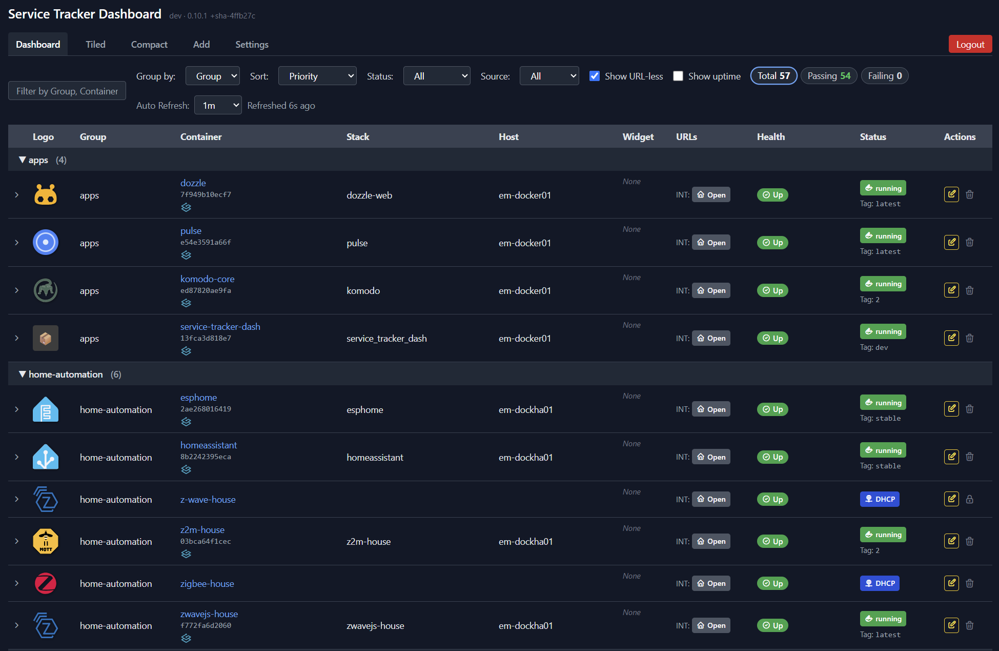](screenshots/std_dashboard.png)

### Dashboard with uptime strips

**Show uptime** adds a 24-hour strip under each entry's health badge.

[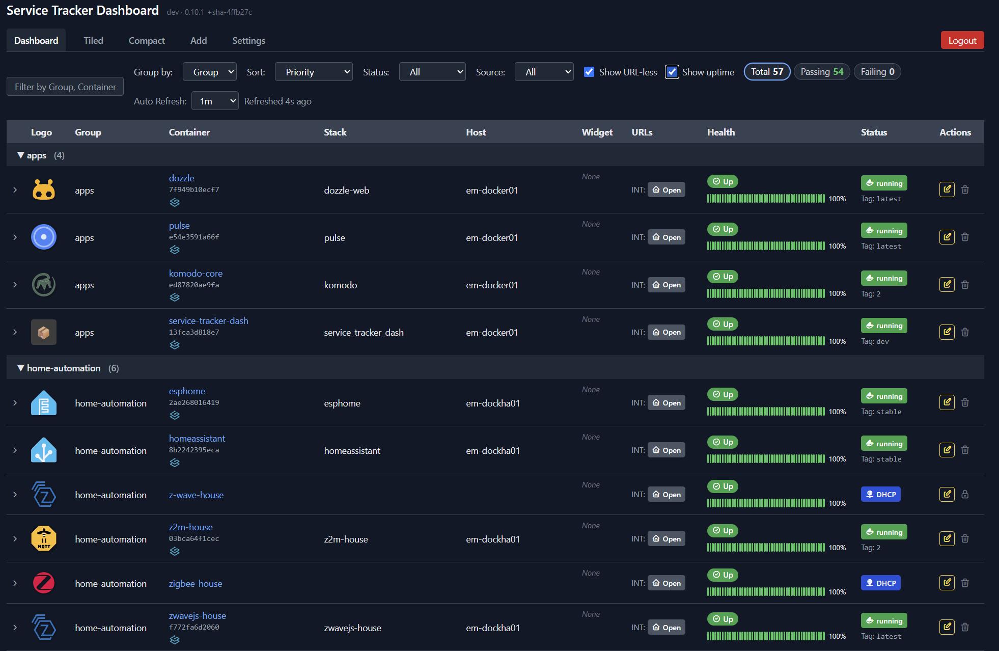](screenshots/std_dashboard_uptime.png)

### Dashboard, row expanded

The chevron opens the entry's details (host, stack, URLs with their last check, Docker
status, networks, ports, exposure) beside its health history and **Check now**.

[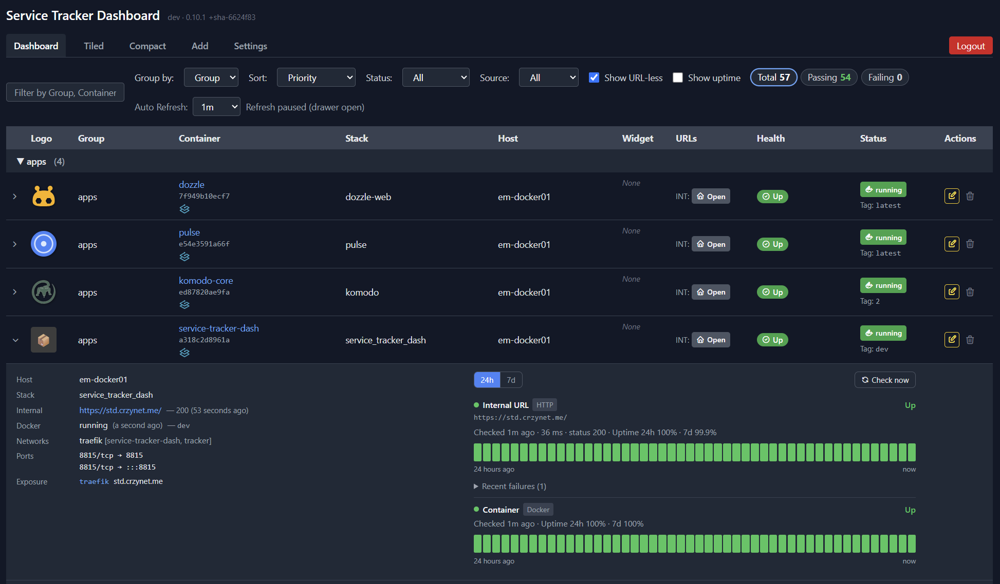](screenshots/std_dashboard_expanded.png)

### Tiled

[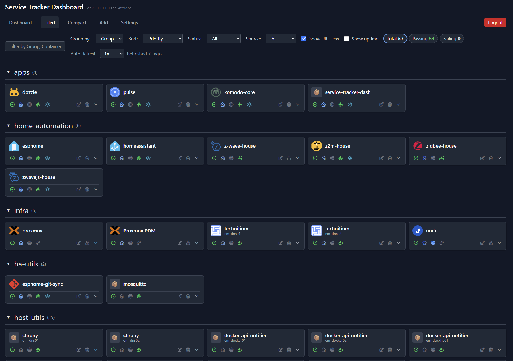](screenshots/std_tiled.png)

### Tiled with uptime strips

[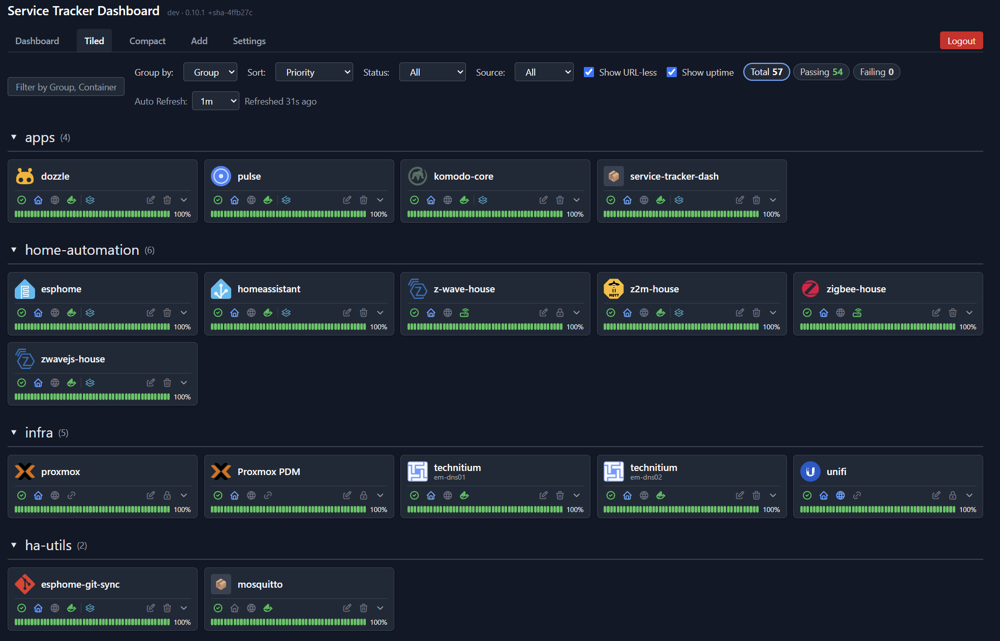](screenshots/std_tiled_uptime.png)

### Tile drawer

A tile's drawer: the same details and health history, plus Edit and Delete.

[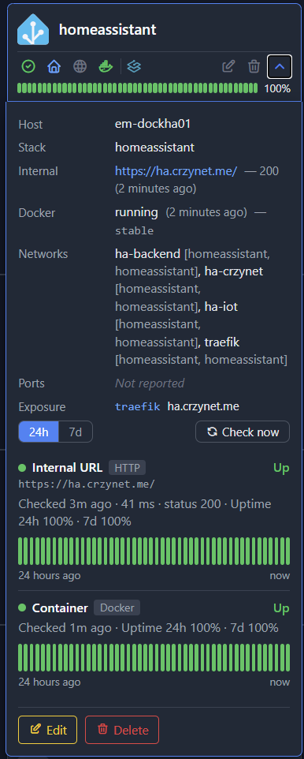](screenshots/std_tiled_expanded.png)

### Compact

Small tiles in columns, one per group; a click opens the entry's URL.

[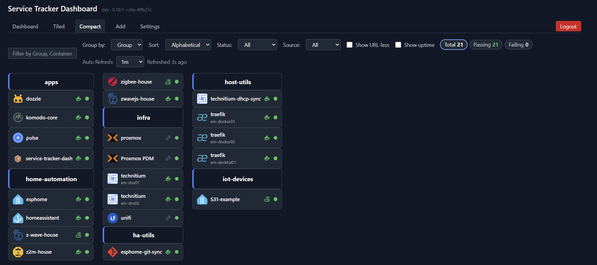](screenshots/std_compact.png)

### Phone

The Tiled view on a phone, and a tile's drawer opened.

| Tiled on a phone | Drawer open |
|---|---|
| [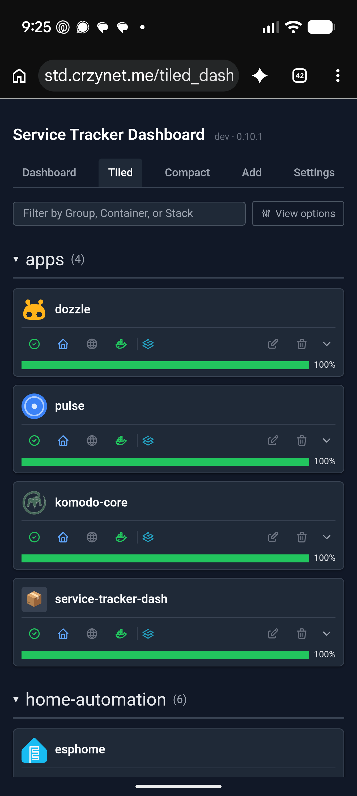](screenshots/std_mobile.png) | [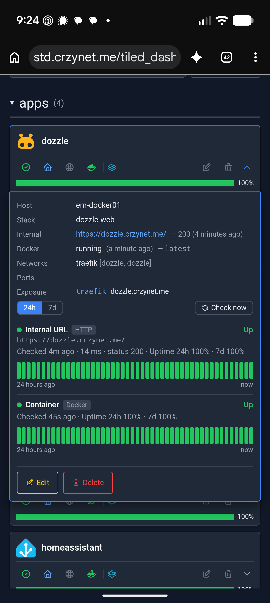](screenshots/std_mobile_expanded.png) |

## Adding entries

### Add entry

A manual entry for anything that isn't a container or in a stream: URLs, group, health
checks, service checks, sort priority, icon, lock and Home Assistant.

[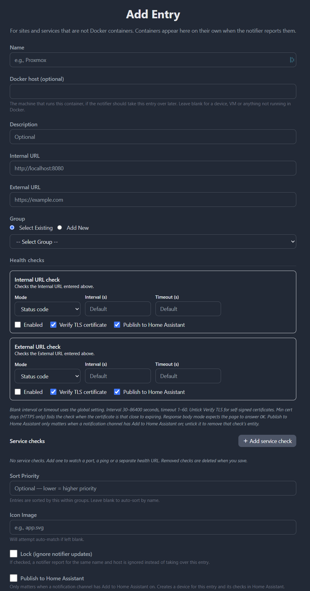](screenshots/std_add_entry.png)

## Settings

### Docker

The register source and how each exposure layer (Traefik, Dockflare, ...) maps to
internal or external URLs, with per-host overrides.

[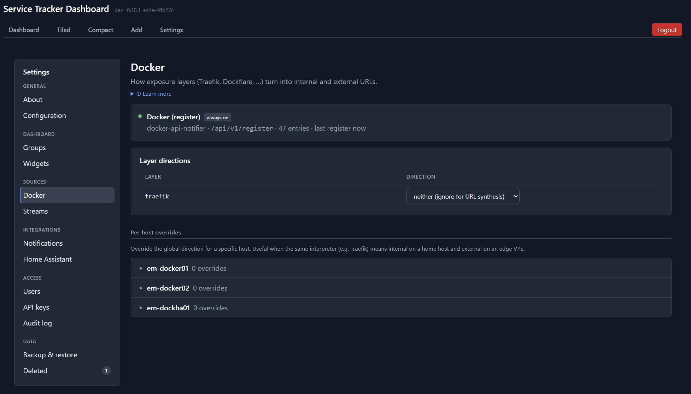](screenshots/std_settings_docker.png)

### Streams

Inventory streams pushed by sidecars (here DHCP from Technitium), with blocked items
and link offers.

[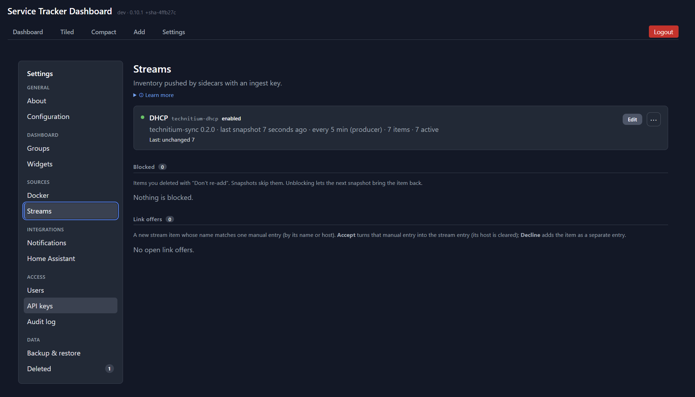](screenshots/std_settings_streams.png)

### Home Assistant

Pick which entries get a Home Assistant device, grouped by source, with search.

[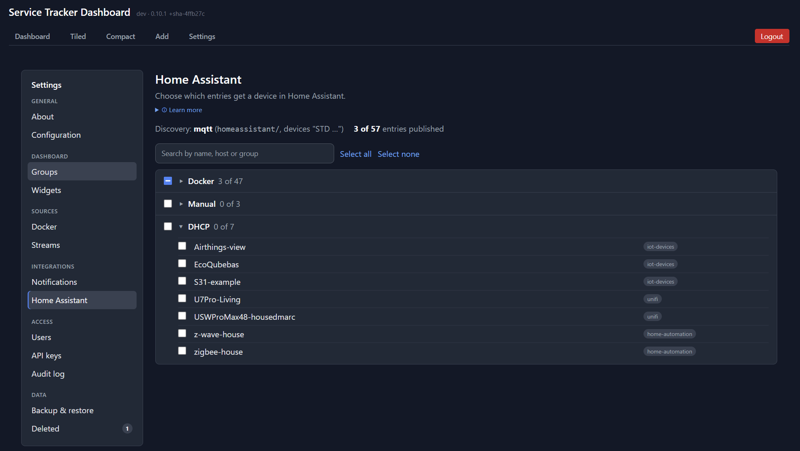](screenshots/std_settings_home_assistant.png)

### Import preview

Importing an export: map its streams to yours, then preview what would be filled in
(here a full match, 47 Docker entries identical) before applying.

[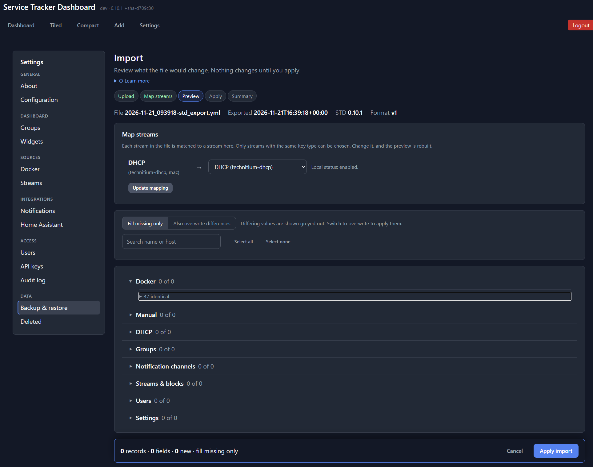](screenshots/std_settings_import.png)

### Audit log

Every management API write: time, key, method, path, object, status and the field changes.

[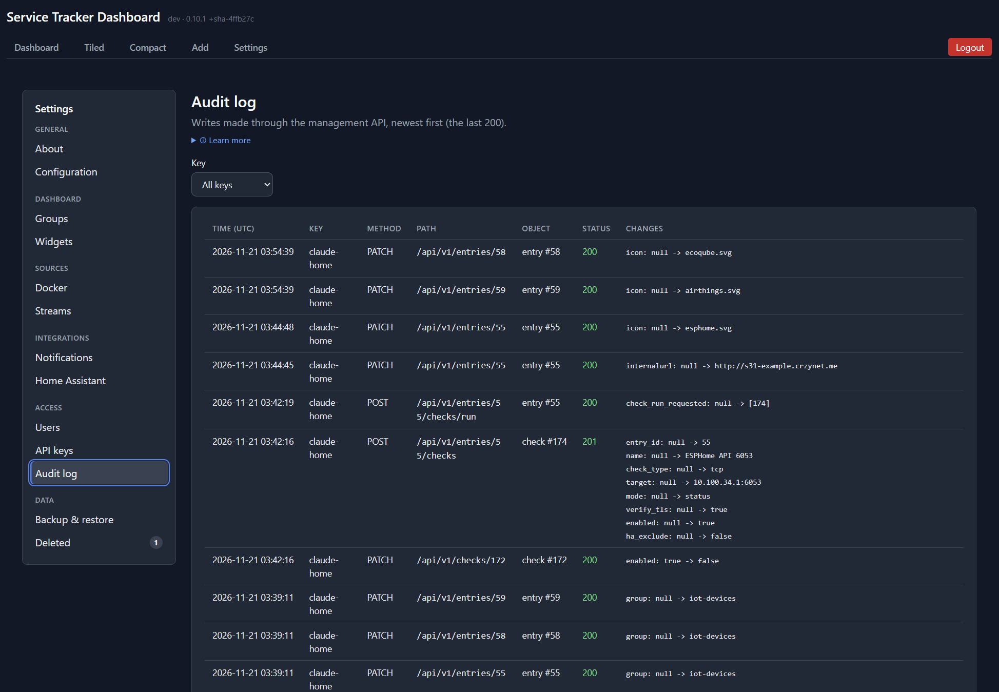](screenshots/std_settings_audit_log.png)
